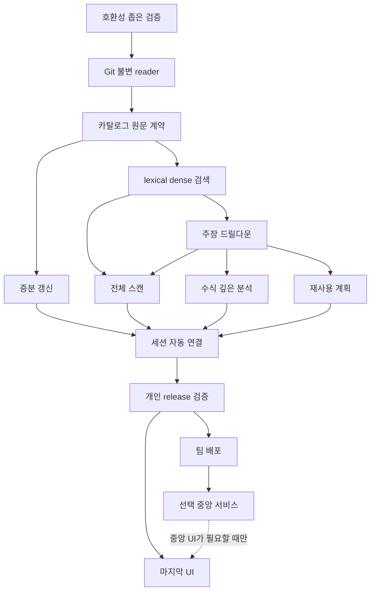

# REFS 구현 인수인계 계획

> Agentic worker는 이 계획과 연결된 설계 문서를 함께 읽는다. 사용 가능한 실행 계획/TDD 방식으로 한 수직 기능씩 구현한다. 이 문서에 없는 새로운 플랫폼 도입이나 대규모 범용화를 선행하지 않는다.

**Goal:** 서버 없는 사내 Git 레퍼런스 도구를 만들고, 자연어 발견→원문→갱신→전체/심층 탐색→기존 자산 활용을 실제 회사 환경에서 검증한다.

**Architecture:** 모듈형 TypeScript 코어, Git source adapter, SQLite provenance, QMD semantic adapter, exact code search. CLI·Skill·OMP/선택 stdio MCP는 같은 application service를 호출한다.

**Tech stack:** 조직 승인 Node/TypeScript/Git, QMD 공개 SDK, SQLite, Tree-sitter. 모델 artifact는 승인된 digest로 고정한다. 중앙/기업 provider는 후속 배포로 분리한다.

**Spec:** `00_DECISIONS_AND_SCOPE.md`~`11_PERFORMANCE_AND_EVALUATION.md`, `../contracts/`, `13_ACCEPTANCE_MATRIX.md`.

## Global constraints

- Git 원본/사용자 작업 트리 수정 금지. 모든 증거는 commit/blob/range에 묶인다.
- 기본 Windows 네이티브, WSL/Docker 강제 금지. UI보다 CLI 수직 기능 우선.
- 수동 update는 모든 repo 확인 후 변경분만, rebuild와 별개.
- private source/embedding/model output은 허용 경계 밖에 보내지 않는다.
- 조회 성공, 구현 완료, 테스트 통과, 사용자 acceptance를 구분한다.
- unit 시험 몇 개의 통과를 제품 성능/기업 보안 검증으로 확대하지 않는다.

## Review focus

1. dirty working tree·force-push·CRLF/Unicode에서 원문이 정확한가 — T01/T02/T05.
2. 새 파일·삭제·config 변경이 기존 summary/recipe를 무효화하는가 — T05.
3. summary에서 빠진 작은 함수와 wrapper 사용처를 찾는가 — T03/T06.
4. ‘전체’에서 결과 상한·실패·권한 누락을 감추지 않는가 — T06/T10.
5. code observation이 회사 정책·실행 성공·정확한 수식으로 과승격되지 않는가 — T04/T07/T08.

## 1. 우선순위 및 release 범위

P0: source/evidence identity, 안전한 수집·기초 검색·증분 update·상태/복구. P1: 자연어/전체/심층 수직 기능, 수식/지식 최소 동작, 재사용 계획과 실제 사례, Skill 자동 연결. P2: 품질 튜닝·광범위 언어/SCIP·추출 고도화. P3: 다중 사용자 중앙 배포. P4: UI.

**개인형 실사용 완료는 P0+P1이 모두 통과한 상태**다. 단순 top-k 검색만 완성하고 최종 목표를 달성했다고 하지 않는다. 증분 update와 Jira 전체 탐색, SSD 수식·원문 탐색은 첫 release의 필수 E2E 사례다.

## 2. 의존성



T03과 T05는 계약 확정 후 병렬 가능하다. T06·T07·T08은 독립 범위에서 병렬 검토할 수 있다. core types/SQL migration/generation publisher는 단일 writer 책임을 둔다. 통합 검사는 직렬로 실행하고 완료한 범위를 다시 작성하지 않는다.

## 3. 구현할 파일 구조

```text
src/
  contracts/                 # 외부 요청/응답, 생성 타입
  inventory/                 # repos.yaml, ref/권한 scope
  sources/git-source.ts      # 고정 Git 객체 읽기
  catalog/catalog.ts         # source/asset/evidence/edge
  catalog/migrations/        # schema migration
  indexing/plan-update.ts    # 변경/파생 무효화
  indexing/publish.ts        # staging→READY→active
  indexing/extract.ts        # 근거 기반 카드 추출
  retrieval/qmd-adapter.ts   # 공개 SDK만 사용
  retrieval/exact-scan.ts    # 전체 manifest 문자열/심볼
  retrieval/fusion.ts        # 중복/순위 결합
  analysis/context-pack.ts   # 질문별 근거 묶음
  analysis/trace.ts          # 제한 관계 traversal
  reuse/prepare.ts           # 실행하지 않는 plan
  sessions/session-store.ts  # follow-up continuity
  interfaces/cli.ts
  interfaces/mcp.ts
  integrations/omp.ts
  policy/access.ts
  observability/events.ts
```

## T00 — 설치 가능성을 판정하는 작은 호환성 시험 (P0)

**Files:** `src/interfaces/doctor.ts`, `tests/integration/provider-smoke.test.ts`, `release-lock.json`.
**Consumes:** 회사 승인 런타임/모델·Git 경로.
**Produces:** supported capabilities, 정확한 package/model digests, 조건별 fallback 선택.

- [ ] Node/Git/SQLite native module/QMD 모델 로딩이 실제 target OS에서 되는지 실패 조건부터 검사한다.
- [ ] 작은 합성 corpus로 searchLex/searchVector/원문 mapping/update/delete를 실행한다.
- [ ] stdout JSON 오염, 인터넷 자동 download, CPU-only 동작을 검사한다.
- [ ] 성공한 release만 고정한다. QMD가 필수 계약을 충족하지 못하면 `15_ADR_AND_OSS_REVIEW.md`의 명시 fallback으로 변경하고 반복 연구를 중단한다.
- [ ] Gate G0 evidence: 명령/환경/로그/digests. 외부 인터넷 허용 여부는 실제 요청을 보내기 전 조직 정책으로 정한다.

## T01 — Git 불변 원문 reader (P0)

**Files:** `src/sources/git-source.ts`; `tests/sources/git-source.test.ts`.
**Consumes:** registered repo ID, commit, source path/blob.
**Produces:** `readSource(SourceRef, AccessContext): Promise<VerifiedSource>`.

- [ ] dirty working-tree 값과 커밋 값이 다른 테스트를 작성한다. 반환은 반드시 커밋 값이어야 한다.
- [ ] Unicode/공백/tab 경로, CRLF, 범위 초과, blob hash mismatch, symlink/gitlink, SHA-256 형식을 검사한다.
- [ ] Git 객체를 argv 배열로 읽고 외부 diff/filter/hook을 실행하지 않는다.
- [ ] Gate G1: 원문 hash/range를 반복 검증하고 원본 checkout 변경이 없어야 한다.

## T02 — 카탈로그·Evidence 계약 (P0)

**Files:** `src/catalog/*`, `src/contracts/*`, `tests/catalog/provenance.test.ts`.
**Consumes:** VerifiedSource.
**Produces:** immutable EvidenceRef, asset version, relation, manifest.

- [ ] 없는 source ID/다른 commit/range를 가진 evidence가 게시되지 않는 테스트부터 작성한다.
- [ ] `../contracts/catalog.sql`을 기준으로 migration과 unique/FK 검사 구현.
- [ ] logical asset ID와 version/evidence ID 분리. generated snippet과 source line mapping을 보존.
- [ ] Gate G2: 모든 fixture claim은 유효 source 또는 inferred/unverified 상태를 가져야 한다.

## T03 — 최초 검색 수직 기능 (P0)

**Files:** `src/retrieval/{qmd-adapter,exact-scan,fusion}.ts`, `src/interfaces/cli.ts`.
**Consumes:** catalog+QMD index+query.
**Produces:** SearchResponse와 evidence ID.

- [ ] 제목에 없는 함수, Korean/English alias, exact symbol, docs-only decoy fixture를 먼저 만든다.
- [ ] project/capability/knowledge/source lane을 구현하고 parent summary가 하위 검색을 막지 않게 한다.
- [ ] RRF 중복 lane 계산·deterministic tie·후보 다양성 테스트. 참조 구현을 사용해도 원시/결합 점수를 이중 반영하지 않는다.
- [ ] Gate G3: `refs search → refs evidence`가 실제 fixture Git에서 끝까지 작동한다. 이 단계의 성능은 초기값이며 최종 quality gate는 T10이다.

## T04 — 원문 드릴다운·주장 표시 (P1)

**Files:** `src/analysis/{trace,context-pack}.ts`, `tests/analysis/drilldown.test.ts`.
**Consumes:** asset/symbol/evidence/session.
**Produces:** source/definition/reference/test/usage view와 resolution level.

- [ ] 같은 이름의 무관 함수, 해석 불가 dynamic call, 테스트 이름만 유사한 파일 반례를 작성한다.
- [ ] 제한 BFS, cycle 방지, unresolved edge와 supporting source를 반환한다.
- [ ] 문서와 코드 충돌을 별도 주장으로 표현한다.
- [ ] Gate G4: 모든 핵심 설명에서 원문으로 이동하며 유추와 관찰이 구분된다.

## T05 — update/rebuild/삭제/실패 복구 (P0, 초기부터 병행)

**Files:** `src/indexing/{plan-update,publish}.ts`, `tests/indexing/update.test.ts`.
**Consumes:** previous manifest, target tree, fingerprints.
**Produces:** UpdatePlan/UpdateReceipt, new READY generation.

- [ ] unchanged→0 reembed, rename→mapping만 변경 가능, delete→파생 무효화, 신규파일→parent card 갱신 테스트를 먼저 작성한다.
- [ ] config/lock/policy 변경에 대한 semantic invalidation을 벡터 재계산과 분리한다.
- [ ] writer 충돌·disk full·kill-before-publish·partial Git fetch를 fault injection한다.
- [ ] Gate G5: last READY 보존, 재개 가능, update --all은 rebuild가 아니어야 한다.

## T06 — Jira 전체 탐색 (P1)

**Files:** `src/retrieval/exact-scan.ts`, `src/detectors/jira.ts`, `tests/e2e/jira-all.test.ts`.
**Consumes:** full allowed manifest, detector pack, exact scan provider.
**Produces:** paginated complete candidate set, per-repo decisions, CoverageReport.

- [ ] direct/wrapper/dependency-only/docs-only/test-only/동적 unresolved fixture를 만든다.
- [ ] top-k와 repo 다양성 제한이 전체 occurrence를 삭제하지 않게 한다.
- [ ] 일부 repo 실패와 hidden/ignored tracked 파일을 검사한다.
- [ ] Gate G6: 알려진 fixture 정답 전부, 거짓 사용 확정 0, 처리 못한 범위 명시. 사내 의미상 완전성은 보장하지 않는다.

## T07 — 수식·전문 지식 최소 동작 (P1)

**Files:** `src/analysis/formula.ts`, `tests/e2e/thermal-drilldown.test.ts`.
**Consumes:** calculation source, parameter/config/test evidence.
**Produces:** FormulaCard/KnowledgeClaim/context pack.

- [ ] single-node Euler fixture와 decoy keyword 문서를 준비한다.
- [ ] 이산식·연속식 연결, units/initial/boundary/step/clamp/parameter source를 확인한다.
- [ ] 모델이 교과서식을 임의 삽입하거나 test 존재를 passed로 올리는 반례를 검사한다.
- [ ] Gate G7: 실제 코드식과 각 필드 근거가 일치하고 unknown을 보존한다.

## T08 — 기존 자산 활용 (P1)

**Files:** `src/reuse/prepare.ts`, `src/reuse/receipt.ts`, `tests/reuse/prepare.test.ts`.
**Consumes:** selected asset version, environment binding, intent/policy.
**Produces:** ReusePlan/ExecutionReceipt 연동.

- [ ] ready/needs_setup/needs_verification/reference_only와 service version drift 테스트.
- [ ] prepared input과 실제 실행 input이 다르면 재검증한다.
- [ ] 하네스의 기존 mock/local 도구로 하나의 read operation을 수행하고 진짜 receipt를 연결한다.
- [ ] Gate G8: 조회 또는 SDK 재사용 1개가 E2E로 성공. 사내 API 성공은 현장 별도 기록이다.

## T09 — 세션·Skill·OMP 연결 (P1)

**Files:** `src/sessions/*`, `src/integrations/omp.ts`, `skills/internal-reuse/SKILL.md`.
**Consumes:** user intent/task event, query context, manifests.
**Produces:** 자동 탐색과 연속 drilldown.

- [ ] 새 목표는 탐색, 같은 목표의 사소 수정은 중복 억제, revive/empty event는 미발동 테스트.
- [ ] ‘두 번째 후보’ 선택 후 update가 발생해도 기존 source가 몰래 바뀌지 않아야 한다.
- [ ] ‘최신 전체 깊게’ 요청에서는 update+all+deep을 수행하고 재확인을 반복하지 않는다.
- [ ] Gate G9: 실제 설치 하네스에서 네 사용자 시나리오를 녹화/로그로 확인. SKILL.md 존재만으로 PASS 금지.

## T10 — 개인형 release 검증 (P1)

**Files:** `tests/acceptance/*`, `bench/*`, `docs/verification/local-release.md`.
**Consumes:** E2E 기능, holdout questions, real target PC.
**Produces:** measured report and explicit release decision.

- [ ] Hit/Recall/evidence/latency/cold-warm/update memory를 분리 측정한다.
- [ ] 최소지원 OS/CPU·승인 model·오프라인 정책 시나리오 확인.
- [ ] Jira all + SSD formula + 실제 reuse + update mutation + malicious source + 권한 회수 회귀를 실행.
- [ ] Gate G10: P0/P1 matrix에서 blocker가 없고 실제 사용자 acceptance를 받았을 때만 개인형 Accepted.

## T11 — 팀 설치형 배포 (P2)

**Files:** `packaging/*`, `docs/runbooks/install.md`, `tests/package-smoke/*`.
**Produces:** 승인된 offline package, install/update/rollback/uninstall.

앱/스킬/모델 배포와 데이터 배포를 분리한다. 사용자 Git을 보존하고 자동 external telemetry/download가 없어야 한다. 별도 서버 없이 두 사용자 PC에서 각자 권한으로 E2E 동작하면 G11 통과다.

## T12 — 중앙/혼합 배포 (P3, 실제 수요 있을 때)

**Files:** `src/providers/postgres/*`, `src/interfaces/http/*`, `src/policy/enterprise/*`.

SSO/Git principal mapping, RLS/service role, per-user retrieval, ACL change/backup/rollback/concurrency를 검증한다. 기존 Sourcegraph 재사용 가능성부터 확인한다. G12는 기업 보안·운영 acceptance이며 개인형 완료와 별개다.

## T13 — UI (P4)

공통 API를 소비하는 결과·원문·관계·사용법·작업 상태 화면만 설계한다. UI 없는 상태에서 모든 기존 acceptance를 통과해야 한다. 시작 조건은 G10 이후이며 기업 UI는 G12와 별도다.

## 4. 완료 수준과 증거

각 작업은 `Designed → Implemented → Verified → Accepted`로 상태를 기록한다. 현재 설계 산출물과 일부 참조 core의 검사는 제품의 Accepted를 뜻하지 않는다. Gate마다 명령·환경·source/model version·결과·실패/미검증·수정 commit을 남긴다. 매 단계마다 대규모 독립 감사나 과도한 보고서 생성을 반복하지 않는다. 실패한 경계와 마지막 통합 범위를 집중 검증한다.

## 5. 중단·재개

한 작업의 승인된 목표·수정 파일·테스트 결과·미해결 실패·다음 작업·read-only 경계를 짧은 checkpoint로 남긴다. 다음 세션은 최신 완료 상태를 읽고 이미 완료한 기능을 재구현하지 않는다. 회사 환경 때문에 필요한 adapter를 바꾸더라도 전체 설계·스키마를 임의로 다시 쓰지 않는다.
