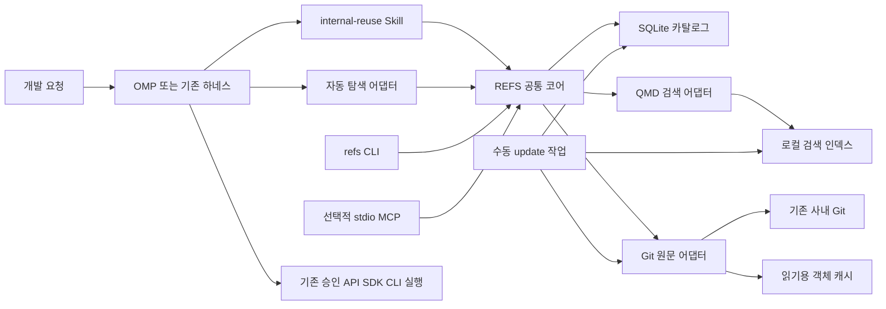
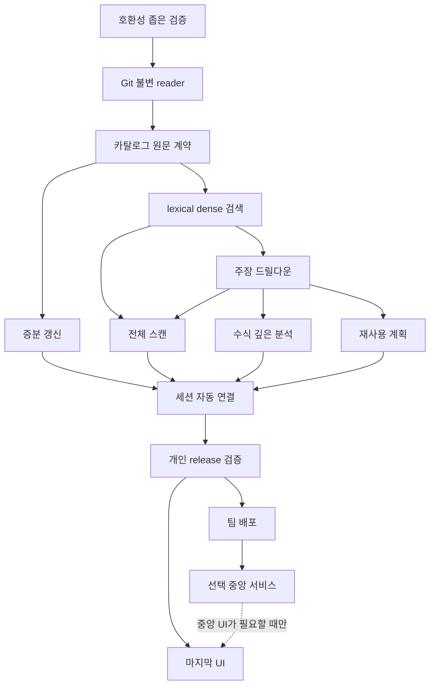
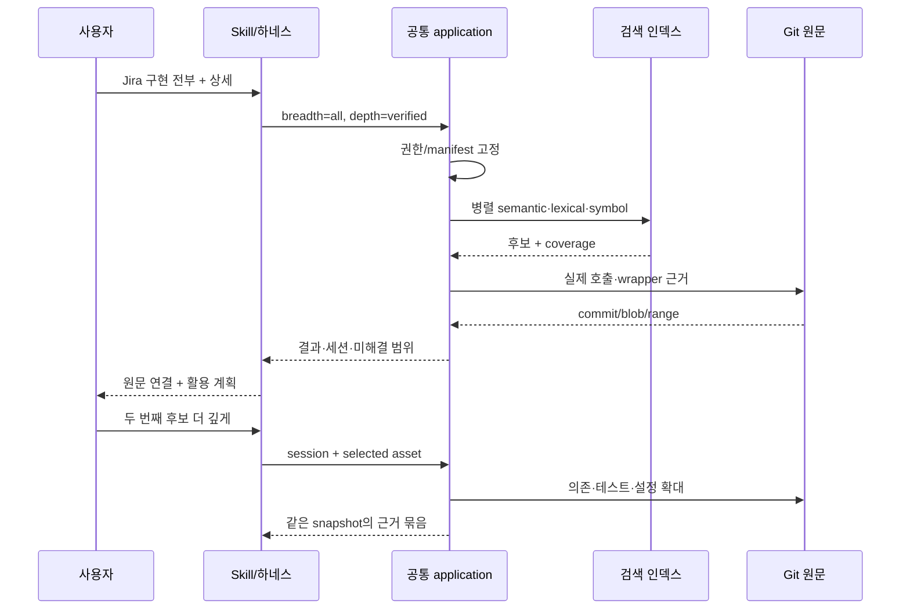
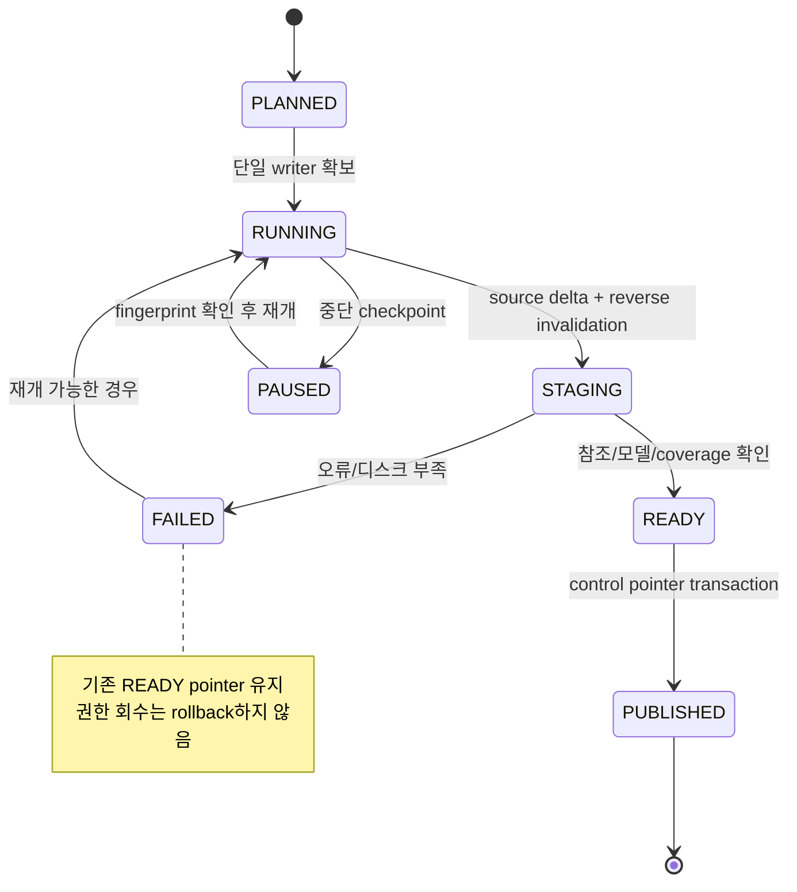
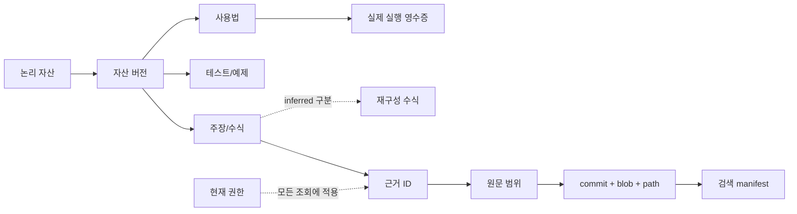
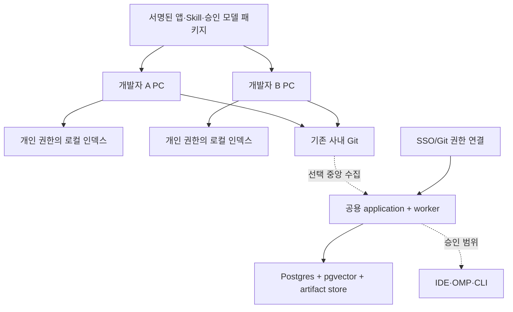
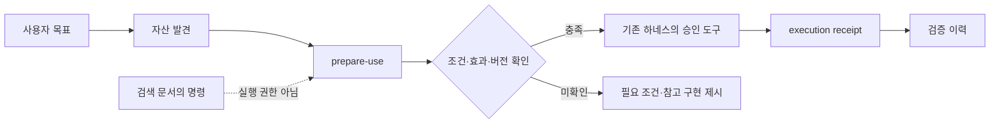

# REFS 최종 설계서

## 사내 Git 기반 기술 지식·코드 발견·원문 드릴다운·재사용 플랫폼

**설계 기준일 2026-11-02 · Local-first · UI 마지막 · 사내 구현 인수인계용**

이 문서는 이전 프롬프트를 실행한 최종 설계 결과다. 제품 전체 개발 완료 보고서가 아니다. 상세 결정·계약·수직 구현 계획·완료 기준을 제공하고, 별도 폴더에는 실제 시험한 제한된 참조 코어와 기계 검증 계약을 담았다.

**먼저 읽을 결론:** 개인/팀 설치형에는 별도 서버를 요구하지 않는다. Git 원본 + 로컬 provenance catalog + QMD adapter + exact source scan + Skill/하네스 연결을 사용한다. 모든 사실은 특정 snapshot의 근거로 내려가며, 전체 탐색 범위와 분석 깊이는 별도로 제어한다. 수동 증분 갱신은 P0, Jira 전체 탐색과 SSD 수식·원문은 첫 실사용의 필수 시나리오다.

**검증의 한계:** 외부 공식 문서와 공개 코드는 확인했지만 사내 Git/모델/검색 엔진/OMP를 설치하거나 실제 회사 환경에서 실행하지 않았다. 정확한 설치 버전과 모델 digest는 G0에서 고정한다. 속도·Recall 수치는 목표다. 합성 예시를 사내 발견물로 해석하지 않는다.

## 목차

- [00. 최종 결정·범위·기존 설계 수정](#part-00)

- [01. 아키텍처·프로세스·책임 경계](#part-01)

- [02. 데이터 모델·식별자·권위](#part-02)

- [03. Git 수집·수동 갱신·증분 무효화·복구](#part-03)

- [04. 빠름·정확함·깊이·전체성을 함께 갖춘 검색](#part-04)

- [05. 원문 드릴다운과 근거 그래프](#part-05)

- [06. 전문 지식·수식·Jira/SSD 시나리오](#part-06)

- [07. API 직접 사용·SDK·코드 재사용](#part-07)

- [08. CLI·MCP·Skill·자동 탐색 계약](#part-08)

- [09. 사내 제약·권한·비밀·위협 모델](#part-09)

- [10. 배포·기업 확장·운영 인수인계](#part-10)

- [11. 성능·정확도·비용·평가 설계](#part-11)

- [REFS 구현 인수인계 계획](#part-12)

- [13. 요구사항 추적 및 완료 기준](#part-13)

- [14. Source Atlas · 공개 근거와 검증 한계](#part-14)

- [15. OSS 비교·선정·탈락 근거·ADR](#part-15)

- [16. 사내 바이브코딩 시작 프롬프트·환경 입력](#part-16)

- [17. 남은 위험·추후 UI](#part-17)

- [18. 이번 산출물의 실제 완료 범위](#part-18)

- [설계도 모음](#diagrams)

- [부록 A: 핵심 TypeScript port](#appendix-ports)

- [부록 B: 파생 catalog SQL](#appendix-catalog)

- [부록 C: control/운영 SQL](#appendix-control)

- [검증 보고서와 실행 코드](verification/REPORT.md)

## 읽는 순서

전체 방향은 00~01, 구현자는 02~08과 12~13, 기업 배포 검토자는 09~11과 15를 읽는다. 16의 인수인계로 사내 구현을 시작하고 실제 증거를 붙여 Gate를 닫는다. 문서 안에서 상대 코드 경로를 설명하는 부분은 패키지 기준 경로와 함께 해석한다.

---

<a id="part-00"></a>

# 00. 최종 결정·범위·기존 설계 수정

**제품 가칭: REFS — 사내 코드·기술 지식 탐색 및 재사용 도우미.**

설계 기준일은 2026-11-02다. 이 문서는 구현을 위한 최종 기준선이며 사내 데이터로 실측한 운영 인증서는 아니다. 현재 대화에 제공된 기존 설계, 마스터 프롬프트 및 잘린 우선순위 지시를 통합했다. 기존 Space 문서를 별도 재열람했다고 주장하지 않는다. 외부 기능의 근거는 `14_SOURCE_ATLAS.md`, 실제로 실행한 검사는 `../verification/REPORT.md`에서 구분한다.

## 1. 사용자가 실제로 얻는 것

평소의 개발 질문에 기존 사내 구현을 찾아 주고, 발견한 기능·수식·업무 규칙을 코드와 테스트로 확인하며, 같은 탐색을 이어서 바로 사용하거나 수정·재사용하게 한다. 항상 불변 원문과 연결되며, 원문이 회수·소실되어 열 수 없는 경우에도 그 상태를 숨기지 않는다. UI가 없어도 CLI·Skill·개발 하네스에서 완결된다.

출력의 기본 형태는 **무엇을 찾았는가 → 어디에 구현돼 있는가 → 어떤 조건에서 쓸 수 있는가 → 다음에 무엇을 확인하거나 실행할 수 있는가**다. 단순 Git URL 모음이나, 근거 없는 AI 요약집이 아니다.

## 2. 확정 기준선

| 영역 | 결정 | 이유 |
|---|---|---|
| 첫 배포 | 사용자 PC에 설치하는 로컬 패키지 | 별도 서버 운영 없이 시작한다. Windows 네이티브를 1차 지원 대상으로 하고 WSL2를 의무화하지 않는다. |
| 코드 원본 | 기존 Git의 고정 커밋 | 사용자 작업 트리를 수정하지 않는다. 읽기용 Git 객체 캐시는 원본의 복제일 뿐 정본이 아니다. |
| 구현 언어 | TypeScript, 조직 승인 Node LTS | OMP·MCP·로컬 도구 연결을 한 언어로 묶는다. 임베딩 모델을 직접 구현하지 않는다. |
| 카탈로그 | SQLite | 자산·근거·관계·세션·갱신 상태를 저장한다. 별도 DB 서버는 없다. |
| 기본 의미 검색 | QMD 공개 SDK를 감싼 좁은 어댑터 | 기존 하이브리드 검색과 모델 실행을 재사용한다. 내부 DB 구조에는 의존하지 않는다. |
| 정확 검색 | 심볼 카탈로그 + Git 객체/지정 파일의 문자열·정규식 탐색 | 벡터 점수로 코드 존재나 전체 탐색을 판정하지 않는다. |
| 임베딩 | 요약·기능·지식과 적격 1st-party 코드 조각 | 프로젝트 개요에 숨은 작은 기능도 직접 검색한다. 모든 함수의 LLM 요약은 하지 않는다. |
| 모델 초기 후보 | Qwen3-Embedding-0.6B / Qwen3-Reranker-0.6B | 로컬 비용과 라이선스 표기를 고려한 출발점이다. 내부 질문 성능 우승 모델로 주장하지 않는다. |
| 코드 구조 | Tree-sitter 기본, SCIP import 선택, LSP 현장 사용 | 구문·해석된 참조·실행 동작을 구분한다. 모든 언어의 완전 호출 그래프를 만들지 않는다. |
| 사용 인터페이스 | CLI + 공통 Skill, OMP 자동 탐색 어댑터 | 로컬 MCP는 같은 코어를 노출하는 얇은 stdio 어댑터다. |
| 깊은 분석 | 기존 OMP/개발 하네스 | 새 워크플로 엔진·디렉터·메모리 시스템을 만들지 않는다. |
| 갱신 | 명시적 수동 갱신이 기본 | 전체 확인과 전체 재생성을 구분한다. 상시 폴링·자동 스케줄은 기본 꺼짐이다. |
| 조직 확대 | 설치 패키지 배포 → 필요 시 중앙/혼합형 | 패키지 배포만으로도 여러 사람이 쓸 수 있다. 다중 사용자 중앙 서버가 필수는 아니다. |
| UI | 마지막 선택 단계 | 모든 기능은 기계가 읽을 수 있는 계약으로 먼저 구현한다. |

QMD의 공개 API에서 검색·갱신·임베딩 제어점을 확인했다. 실제 Windows 설치, 사내 프록시, 모델 바이너리, 대규모 성능은 여기서 실행하지 않았다. 따라서 1차 현장 Gate는 **선택한 QMD release가 아래 계약을 충족하는지 확인하는 호환성 검사**다. 새 아키텍처 연구를 반복하는 단계가 아니다. [S01](#s01) · [S02](#s02) · [S03](#s03) · [S04](#s04) · [S36](#s36)

## 3. 명시적으로 바꾼 이전 제안

| 이전 제안 또는 표현 | 최종 수정 |
|---|---|
| FAST/PRECISE/DEEP/EXHAUSTIVE를 서로 다른 단계로 취급 | 깊이 `fast/verified/deep`와 범위 `ranked/all`를 분리한다. DEEP+ALL 가능. |
| 전체 업데이트와 rebuild 의미가 혼재 | `update --all`은 모든 등록 저장소의 변경 확인 + 변경분 처리. `rebuild`는 파생 데이터를 강제 재생성. |
| 갱신·수식·전체 탐색이 후반 단계 | 증분 갱신은 P0, 수식·전체 탐색의 최소 수직 기능은 P1에 포함한다. |
| 모든 원문을 즉시 LLM으로 정밀 해석 | 전체 적격 소스는 검색 가능하게 만들되 LLM 해석은 우선 기능과 실제 질문에 집중한다. |
| 요약 상위 저장소에서만 하위 탐색 | 원문·기능·지식을 전체 허용 범위에서 병렬 탐색한다. |
| ‘Recall@5 90%’로 한 개 정답 발견 측정 | 한 개 이상 정답 발견은 Hit@5. 다중 정답은 Recall@k 및 전체 탐색의 엔티티별 Recall로 별도 측정. |
| 일반 답변 8초 보장처럼 해석 가능 | 인덱스 조회·제한 재정렬 목표와 모델 답변 생성·코드 분석 시간을 분리한다. |
| QMD collection/metadata를 ACL처럼 취급 가능 | 권한은 자체 서비스/배포 경계가 담당한다. 확인한 SDK 계약에 없는 ACL 기능을 발명하지 않는다. |
| EmbeddingGemma가 영어 전용/한국어에 부적합하다는 단정 | 공식 모델 카드는 100+ 언어와 기술·코드 데이터 학습을 설명한다. 내부 성능은 A/B로 판단. [S24](#s24) |
| GitLab의 특정 GA 버전이 사내 사용 가능성을 보장 | 공개 문서/검색 시점에 표기가 달라질 수 있다. 설치 환경의 버전·tools list·실제 API로 능력 감지. [S15](#s15) · [S16](#s16) · [S17](#s17) |
| 모든 파생 정보는 삭제 후 Git으로 완전히 복구 가능 | 인간 보정, 사용 피드백, 비Git 검증 영수증은 별도 운영 원본이므로 백업한다. |
| 원문까지 ‘항상’이라는 말이 접근 보장을 뜻함 | 모든 주장에 탐색 경로를 보존하되 revoked/missing/expired 상태에서는 명시적으로 중단한다. |

## 4. 비목표와 금지하는 확대

첫 버전에서 사내 코드 호스팅 대체, 전사 포털, 자체 벡터 DB, 전언어 정밀 컴파일러, 자동 운영 배포, 범용 셸 실행 서버, 별도 에이전트 오케스트레이터를 만들지 않는다. 개인형에 SSO/RBAC 관리 UI나 Kubernetes를 얹지 않는다. 사용자가 요청한 코드 재사용은 적극 지원하되 저장소 발견을 운영 API 실행 권한으로 해석하지 않는다.

## 5. 현장 미확인 값과 결정 방법

Git 호스트/버전, 저장소 규모, 주 언어, 모델 반입 허용, CPU/GPU/메모리, 승인 패키지 배포 경로, 정책상 캐시 보존 기한은 현장에서 채운다. 값이 없더라도 설계·참조 코드는 사용할 수 있다. 개발 시작 시 `doctor`가 차이를 보고하고 해당 어댑터만 구성한다. 새로운 저장소·토큰·관리자 권한을 가정하지 않는다.

## 6. 최적화 우선순위

사실/권한/원문 정합성은 타협하지 않는다. 그 다음 누락 방지, 근거 정확성, 사용자 대기시간, 인덱싱 비용, 구현량 순으로 최적화한다. ‘가장 큰 모델’이나 ‘그래프 DB’가 최고의 구조라는 전제는 두지 않는다. 실제 실패 유형을 줄이는 가장 작은 변경을 선택한다.


---

<a id="part-01"></a>

# 01. 아키텍처·프로세스·책임 경계

## 1. 로컬 기준 구조



논리적 모듈은 분리하지만 독립 서비스로 모두 나누지 않는다. CLI는 실행 후 종료한다. OMP에서 사용 중에는 확장/stdio 자식 프로세스가 모델 핸들을 유지할 수 있다. 이것은 사용자가 운영하는 24시간 웹 서버가 아니다. 프로세스가 꺼지면 작업이 계속된다고 말하지 않는다.

로컬 인덱싱은 단일 writer 프로세스로 수행한다. 조회 프로세스는 게시된 generation만 읽는다. 모델 메모리를 중복 점유하지 않도록 온라인 세션과 대량 embed 작업을 겹치지 않는 것이 기본이다. 추후 동시 작업이 필요할 때만 호스트 내 worker를 분리한다. GPU를 쓰지 못하면 CPU 경로로 명시 전환하고 성능을 재측정한다.

## 2. 최소 모듈

| 모듈 | 소유 책임 | 하지 않는 일 |
|---|---|---|
| `inventory` | 허용 repo/ref, 스냅샷 manifest, 범위 통계 | 검색 스니펫의 사실 판단 |
| `sources` | Git 객체·API 읽기, 원문 좌표, diff | 사용자 작업 트리 변경, 임의 URL 접근 |
| `catalog` | 버전별 자산·근거·관계·사용법 | 임베딩 모델 실행 |
| `indexing` | parse/chunk/card/extract/embed, 게시·취소 | 매 질문마다 전체 재분석 |
| `retrieval` | lexical/dense/identifier 결합, 전체 스캔, coverage | 자연어 점수를 사실 확률로 변환 |
| `analysis` | 질문별 context pack·미해결 항목 | 새 범용 에이전트 런타임 |
| `reuse` | 현재 조건과 recipe를 조합한 사용 계획 | 자격 증명 보관·운영 실행의 독자 승인 |
| `interfaces` | CLI/stdio MCP/OMP 계약 변환 | 검색 로직 중복 구현 |
| `policy` | 사용자·데이터 처리·출력 경계 | 모델에게 권한 판단을 위임 |

세 가지 외부 port만 먼저 구현한다: `SourceProvider`, `RetrievalProvider`, `ExecutionBridge`. 중앙 배포용 포괄적 plugin framework는 만들지 않는다. 모델과 권한 정책은 소규모 구성 인터페이스로 두되 한 구현을 먼저 완성한다.

## 3. 사용자 요청의 처리

1. 기존 하네스가 질문의 개발 목적과 필요한 범위를 정한다. 짧은 명시적 검색은 분류 모델 없이 명령으로 바로 처리한다.
2. 코어가 현재 권한/캐시 정책과 `snapshot_manifest_id`를 확정한다.
3. 검색 도구가 구조화된 후보와 근거 ID를 반환한다. FAST에서도 생성된 주장은 코드 확인 상태와 구분한다.
4. 하네스는 질문에 필요한 근거만 읽고 설명한다. 사용자에게 논문식 전체 보고서를 매번 강요하지 않는다.
5. ‘전부’ 요청은 별도 inventory-wide scanner로 전체 판정을 수집하고 페이지화한다. 후보 5개로 잘라 완료하지 않는다.
6. 분석/사용 요청이 이어지면 같은 session과 고정된 source snapshot을 유지한다.
7. 실제 실행은 승인된 기존 도구로 넘긴다. 새 지식은 검증된 source ID와 함께 후보로 저장한다.

## 4. Git 캐시의 현실적인 설계

소스가 Git에 있어도 매번 원격에서 모든 파일을 읽으면 빠른 전수 탐색과 오프라인 원문 확인이 어려워진다. 따라서 기본은 **정본이 아닌, 선택한 저장소의 읽기용 Git 객체 캐시**다. 이미 있는 clone을 읽기만 할 수도 있으나 dirty working tree는 정본으로 섞지 않는다.

초기 fetch는 지정 ref와 필요한 객체만 가져온다. partial/shallow clone 지원 여부는 탐지한다. 서버가 filter를 지원하지 않으면 동작을 숨기지 않고 해당 ref의 제한된 clone으로 대체한다. 일반 파일을 보려고 checkout할 필요는 없다. API-only 모드도 제공하되 raw blob의 지연·rate limit·보존 제약을 coverage에 반영한다.

실제 수정/실행은 별도 작업 디렉터리 또는 사용자가 지정한 프로젝트에서 수행한다. 읽기 캐시를 개발용으로 바꾸지 않는다. submodule과 LFS는 별도 원본/권한/용량을 가진 자산이며 자동으로 다 내려받지 않는다.

## 5. 초기 지원과 미지원 동작

기본 파일 검색은 텍스트 언어 전반에서 지원한다. 정밀 구문 분할은 사내 주언어 2~3개부터 등록하되 TS/JS·Python·C/C++를 첫 후보로 둔다. 나머지는 명시적 텍스트 fallback이다. Notebook은 cell ID와 source map을 가진 별도 reader로 도입하고 raw JSON 전체를 코드인 것처럼 해석하지 않는다. PDF·이미지에만 있는 수식은 이번 기본 코드 경로에서 누락 상태로 표시하고 승인된 문서 extractor 확장 대상으로 둔다.

## 6. 환경별 변경 지점

개인/팀 설치형은 같은 패키지를 각자 설치하며 별도 서버가 없다. 중앙형에서는 SourceProvider의 서비스 계정 수집 권한과 사용자별 query 권한을 분리하고 catalog를 PostgreSQL로 교체한다. UI·HTTP는 공통 코어의 외부 어댑터일 뿐이다. 사내 Sourcegraph가 이미 있다면 검색과 정밀 navigation을 provider로 재사용한다. [S18](#s18)


---

<a id="part-02"></a>

# 02. 데이터 모델·식별자·권위

기계 검증 계약은 `../contracts/`에 둔다. 이 문서는 필드의 의미와 변경 규칙을 정의한다. 예시 ID는 모두 합성 데이터이며 실제 사내 저장소를 뜻하지 않는다.

## 1. 원본과 파생 데이터

| 데이터 | 권위 | 보존 원칙 |
|---|---|---|
| 코드·Git 문서 | Git commit/blob | 원문을 바꾸지 않는다. |
| 공식 정책·지원 문서 | 승인된 문서 source/version | Git 코드 관찰과 별도 근거다. |
| 생성 summary·embedding·관계 추정 | 재생성 가능한 파생물 | 원문과 extractor/model version에 연결한다. |
| 인간 보정·공식 확인 | 기록한 주체·시점·대상 범위 | 자동 재생성이 덮어쓰지 않는다. |
| 실행 영수증 | 실제 execution bridge의 receipt | 대상 버전·입력 범위·환경·결과를 남긴다. |
| 세션·작업 진행 | 이 제품의 운영 데이터 | 보존/삭제 정책을 따른다. |

따라서 ‘DB 전부 지워도 Git으로 완전 복구’는 성립하지 않는다. 파생 인덱스와 인간/운영 원본을 분리해 백업한다.

## 2. 네 층과 세부 종류

L0 프로젝트/패키지 카드, L1 기능·API·사용법, L2 기술 주장·수식·알고리즘, L3 원문·심볼·테스트·예제다. 이들은 다른 제품이 아니라 `asset.kind`가 다른 레코드다. 식별 관계는 `contains`, `implements`, `declares`, `references`, `calls`, `depends_on`, `tested_by`, `example_of`, `derived_from`, `contradicts`, `supersedes`, `validated_by`로 시작한다.

`calls`는 반드시 resolver 수준을 갖는다: `lexical_candidate`, `syntax_observed`, `type_resolved`, `runtime_observed`. 이름 문자열이 같은 것은 해석된 호출 관계가 아니다. `tested_by` 역시 가까운 파일명만으로 확정하지 않는다.

## 3. 식별자 세 가지를 분리한다

**Asset ID**는 사람이 이어서 보는 기능의 논리 ID다. **Version ID**는 특정 스냅샷의 의미 표현이다. **Evidence ID**는 특정 원문 범위다. 같은 함수가 이동하면 Asset ID를 이어 줄 수 있지만 자동 rename 추정이 애매하면 새 ID와 `possible_successor` 후보 관계를 만들고 확정하지 않는다.

SourceRef 필수값:

- `host_id`, `repo_id`, `object_format` (`sha1` 또는 `sha256`).
- `commit_oid`, `blob_oid`, `path`, `content_sha256`.
- `byte_start` 포함, `byte_end` 미포함. 표시용 `line_start/line_end`는 1-based inclusive.
- `symbol_key`와 `symbol_resolution` 선택값.
- `encoding`, `line_ending`, `extractor_fingerprint`.

Git의 객체 ID와 순수 파일 bytes의 SHA-256은 다르다. 문자열 길이를 40자로 고정하지 않는다. 줄 번호는 원문 커밋의 표시 좌표이며 그 자체가 영구 ID가 아니다. CRLF 변환·Unicode·multibyte 문자 때문에 byte offset과 column offset을 혼동하지 않는다. 기본 reader는 UTF-8/UTF-8 BOM을 다루고 다른 encoding은 명시적 decoder 설정 없이는 `unsupported_encoding`으로 남긴다. Git path는 임의 bytes를 허용하므로 UTF-8로 표현 불가한 경로는 bytes/base64를 내부 보존하고 일반 인터페이스에서 누락 사유를 표시한다.

## 4. 주요 엔티티

| 엔티티 | 필수 내용 |
|---|---|
| Repository | 안정 host/repo ID, canonical URL, 허용 ref, archive 상태, 정책 참조 |
| Snapshot | repo/ref/commit, fetched_at, content tree, 권한 확인 상태 |
| SourceUnit | blob, 경로, 범위, 종류, symbol, parent unit |
| AssetVersion | logical asset, snapshot, kind, title, description, evidence, extracted_at |
| Claim | 주장, 적용 범위, 조건, 예외, 근거 유형, 반대 근거, 해석 여부 |
| Evidence | 원문 범위, 인용 부분, 원문 확인 상태 |
| Relation | 양쪽 버전 ID, 관계 종류, resolver, evidence IDs |
| Recipe | 진입점, input/output 계약, 버전 조건, 효과, credential 참조, 확인 기록 |
| Generation | catalog version, search index path, source manifest, model fingerprints, state |
| Coverage | intended/eligible/indexed/scanned 범위, 단계별 실패와 제외 이유 |
| Session | goal, query plan, pinned manifest, 결과 집합, 선택 자산, 미해결 질문 |
| Override | 작성자, 대상 ID, 근거, 변경 이유, 유효범위 |
| ExecutionReceipt | tool/operation, parameter digest, code/service version, environment, time, outcome |

본문을 중복 저장하는 이유가 명확해야 한다. Git 객체 캐시는 재현을 위한 bytes, QMD 문서는 검색용 표현, catalog는 관계/근거/업무 상태다. 동일한 전체 코드의 또 다른 FTS 엔진은 초기 기본 구성에 추가하지 않는다.

## 5. 권한 상속

파생 레코드의 `required_scopes`는 사용된 원본들의 제약을 모두 만족해야 하는 **all-of** 집합이다. 서로 독립적인 공개 근거만으로도 동일한 주장을 만들 수 있다면 접근 범위가 다른 별도 표현을 생성한다. 멀티소스 문장을 한 source에만 연결해 다른 source의 내용을 흘리지 않는다. source ID는 비밀이 아니지만 접근은 매번 확인한다.

검색 관련성, freshness, 근거 수준, reuse 상태, 실행 성공 여부를 한 점수나 배지로 합치지 않는다. 필요한 경우 각각의 차원을 표시한다.

## 6. 모델 fingerprint와 캐시

Embedding cache key는 `security_domain + model_artifact_digest + dimension + tokenizer/prompt/normalization + payload_hash`다. 요약 cache는 실제로 읽은 evidence set, extraction instruction, model config를 포함한다. 시간·현재 커밋 같은 비의미 메타데이터를 embedding 본문에 넣지 않아 같은 코드의 무의미한 재임베딩을 막는다.

그러나 blob만 같다고 해석을 무조건 재사용하지 않는다. import target·config·의존성 lock·정책·사용법이 달라지면 해석과 재사용 가능성은 무효화한다. 벡터 bytes 재사용과 의미 검증 재사용은 별개의 결정이다.

## 7. 계약 버전

외부 응답은 `schema_version: "1.0"`, `request_id`, `manifest_id`, `freshness`, `coverage`, `warnings`를 갖는다. additive optional 필드는 minor, 의미 변경·필수 필드 변경은 major다. 미지원 major는 조용히 추정하지 않고 `UNSUPPORTED_SCHEMA`를 반환한다. 생성된 문서 줄 번호를 Git 코드 줄 번호로 전환하는 mapping은 필수다. QMD docid나 snippet은 제품의 Evidence ID를 대체하지 않는다. [S02](#s02) · [S04](#s04)


---

<a id="part-03"></a>

# 03. Git 수집·수동 갱신·증분 무효화·복구

## 1. 명령의 정확한 의미

| CLI | OMP 별칭 예시 | 계약 |
|---|---|---|
| `refs inventory import repos.yaml` | `/refs 등록` | 목록·ref·권한 경계를 등록. 원본 저장소는 변경하지 않음. |
| `refs update --all` | `/refs 전체업데이트` | 등록된 모든 활성 저장소의 변경 여부 확인, 변경분만 처리. |
| `refs update --repo <id>` | `/refs 업데이트 <id>` | 지정 저장소 및 그 파생물만 갱신. |
| `refs update --all --plan` | `/refs 업데이트계획` | 읽기 원격 확인과 예상 처리량 반환. 파생 데이터 게시 안 함. |
| `refs rebuild --all` | `/refs 전체재생성` | 현재 선택 스냅샷에서 parse/extract/embed를 새로 생성. |
| `refs update --resume <job>` | `/refs 재개 <job>` | 살아 있는 작업은 상태 조회, 중단 작업은 checkpoint 기준 재개. |
| `refs cancel <job>` | `/refs 중단 <job>` | 안전 지점에서 취소, 게시된 세대는 유지. |
| `refs status --all` | `/refs 상태` | 시점·commit·coverage·실패·모델·캐시 크기. |
| `refs history <asset> --from <v> --to <v>` | `/refs 변경점 <asset>` | 원문 diff와 확인된 기능/사용법 차이 분리. |

명령 이름은 구현할 계약이다. 이 설계 패키지가 해당 CLI 전체를 설치한 것은 아니다. ‘전체업데이트’는 `rebuild`로 매핑하지 않는다. 기본은 수동이며 스케줄러는 사용자가 켰을 때만 동작한다.

## 2. 최초 수집

등록된 repo/ref만 resolve하고 commit을 고정한다. `Git ls-tree -r -z` 또는 API tree를 통해 파일 inventory를 만든다. Git 객체 bytes를 읽으므로 로컬 ignored/hidden 기본 설정 때문에 tracked 파일을 놓치지 않는다. 큰 파일·binary·vendor·generated·secret·submodule·LFS pointer는 사유별 처리 상태를 남긴다. README와 주석은 입력 데이터이며 지침이나 실행 권한이 아니다.

내용 hash 기반으로 같은 blob의 parse/chunk 결과를 재사용한다. parser 미지원 시 텍스트 단위로 검색 가능성을 유지한다. 함수/클래스·공개 API·문서 절을 기본 chunk로 사용하고 긴 단위는 parent ID를 보존하여 분할한다. 코드 signature/import/짧은 주변 주석은 문맥으로 붙이되 실제 원문 mapping을 남긴다.

프로젝트/패키지 summary는 manifest·exports·주요 모듈·문서를 함께 근거로 만든다. 모든 파일에 비용 높은 생성 모델을 적용하지 않는다. 첫 인덱스에는 근거가 확인된 자산과 `analysis_pending` 상태를 함께 게시할 수 있다. 미완료를 완료로 표시하지 않는다.

## 3. 임베딩 정책

기본 `standard` 정책은 생성 코드 등을 제외한 1st-party 텍스트 소스·문서·테스트의 적격 chunk와 L0–L2 카드를 임베딩한다. 모든 코드를 LLM으로 해설하지는 않는다. 프로토콜/manifest/lock의 반복 항목은 구조 필드로 추출하고 사용자가 찾을 의미가 없는 반복 bytes는 임베딩에서 제외한다.

초기 대규모 데이터가 자원 한도를 넘으면 `budgeted`를 **명시적으로** 켤 수 있다. 이 경우 모든 소스의 exact/lexical 경로를 유지하고, 카드→공개 인터페이스→업무 핵심→나머지 순서로 body embedding을 확장한다. 비임베딩 범위와 선택 규칙을 저장한다. 표준 profile을 구현하면서 budgeted 엔진까지 동시에 만들 필요는 없다. 이전 답변의 ‘모든 코드 임베딩’이라는 문구는 generated/vendor/비밀/바이너리를 포함한다는 뜻이 아니다.

## 4. 증분 알고리즘

```text
acquire writer lock(profile)
freeze intended repository set; resolve target commits once
for each accessible repository:
    if commit and relevant configuration fingerprints unchanged: mark unchanged
    else:
        get changed/deleted/renamed paths(old_commit, target_commit)
        read changed blobs at target_commit, never working-tree HEAD
        reuse identical byte-derived parse/vector cache where valid
        invalidate reverse dependency closure(source → claim/recipe/card)
        add directory membership invalidation for new/deleted files
        invalidate semantic dependents when exports/config/lock/policy changes
        stage source map + derived records + search updates
validate staged references and declared coverage
publish READY generation atomically
release lock
```

`diff old new --name-status -z -M` 형태의 NUL-delimited 결과를 처리한다. 경로의 공백·탭·개행을 split whitespace로 파싱하지 않는다. rename은 Git의 추정 결과이며 논리 자산 identity의 확정 증거와 구분한다. [S30](#s30)

새 파일이 생겼을 때 과거 summary가 그 파일을 근거로 갖지 않았다는 이유로 summary 갱신을 생략하면 안 된다. package/directory membership digest를 summary dependency로 등록한다. dependency lock 변경은 package 호환성과 recipe를 재검토하지만 모든 unchanged blob을 다시 임베딩하지 않는다.

## 5. force push·태그·브랜치 변경

branch head의 fast-forward 여부와 무관하게 선택한 두 tree를 비교한다. base commit이 없어졌거나 shallow 경계 밖이면 필요한 객체를 조회하고, 불가하면 해당 저장소의 전체 manifest 차이를 계산한다. Git hosting ref는 이동할 수 있으므로 tag도 실제 commit에 resolve한다. snapshot을 보관해야 하는 기간에는 private cache ref 또는 고정 blob cache로 객체를 pin한다. 단순 웹 permalink만 저장하면 원격 GC 후 열리지 않을 수 있다.

기본 브랜치가 바뀌면 기존 ref를 조용히 새로운 ref로 덮지 않는다. `track_default_branch` 정책과 변경 기록에 따라 새 snapshot을 선택한다. submodule은 상위 커밋의 gitlink와 실제 하위 snapshot을 따로 기록한다.

## 6. 원자적 게시와 운영 비용

첫 로컬 버전은 하나의 profile 단위로 catalog·QMD DB와 manifest를 새 generation 디렉터리에 준비한다. 기존 QMD DB는 SQLite의 지원 백업 방식으로 일관된 사본을 만들고 변경만 반영할 수 있다. DB bytes 사본 비용과 semantic re-embedding 비용은 다르다. 지원되는 copy-on-write snapshot이 없으면 DB 전체 I/O가 발생할 수 있음을 성능 보고에 포함한다. 활성 WAL DB 파일만 일반 복사하지 않는다. [S32](#s32)

1. `PREPARING` 디렉터리와 update journal 생성.
2. source snapshot, catalog rows, search index를 같은 manifest 기준으로 stage.
3. source/evidence 참조·schema·embedding fingerprint와 필수 coverage 확인.
4. directory를 `READY`로 만들고 fsync 가능한 파일/메타데이터를 flush.
5. 작은 control DB의 active generation pointer를 트랜잭션으로 교체.
6. 진행 중인 요청은 lease한 세대를 끝까지 읽고, 다음 요청만 새 세대 사용.

Windows에서 사용 중인 DB 파일 rename을 강제하지 않는다. 새 경로+pointer 교체 후 reader lease가 끝나면 이전 파일을 정리한다. 디스크 부족·process kill·QMD 실패 시 pointer를 바꾸지 않는다. resume 시 staging 상태와 source fingerprint가 같은지 검증한다. 같은 수동 명령이 두 번 들어오면 동일 job fingerprint로 합치거나 `WRITER_BUSY`를 반환한다.

전체 갱신 중 일부 repo 접근이 실패하면 성공한 repo의 새 snapshot과 실패한 repo의 마지막 정상 snapshot을 포함한 **명시적 mixed-freshness manifest**를 게시할 수 있다. 실패 repo는 stale이며 회수된 권한은 즉시 차단한다. ‘전체 최신화 성공’으로 표시하지 않는다. 전체 검색의 fresh 요구를 충족하지 못하면 결과 상태는 partial이다.

## 7. 롤백·보존·변경 리포트

롤백은 이전 READY pointer를 선택하되 현재 권한 deny 상태를 되돌리지 않는다. 최신 generation 2개와 진행 작업의 pinned evidence를 기본 보존하고 회사 정책으로 조정한다. 오래된 generation 만료 시 기존 session은 `GENERATION_EXPIRED`와 재탐색 경로를 받는다. 수동 보정과 실행 영수증은 별도 백업한다.

갱신 리포트에는 `checked / changed / unchanged / failed / revoked`, 읽은 bytes, 신규/재사용 vector 수, 무효화 claim 수, 삭제 자산, parse fallback, 게시 세대를 기록한다. ‘바뀐 수식/호출/사용법’은 원문 diff로 확인한 것과 AI의 의미 해석을 구분해 표시한다.


---

<a id="part-04"></a>

# 04. 빠름·정확함·깊이·전체성을 함께 갖춘 검색

## 1. 두 축으로 모델링한다

`depth = fast | verified | deep`, `breadth = ranked | all`이다. 사용자 친화 별칭 FAST/PRECISE/DEEP/EXHAUSTIVE는 유지하지만 내부에서 네 종류의 검색 엔진을 만들지 않는다.

| 요청 | 깊이·범위 | 동작 |
|---|---|---|
| ‘관련 코드 있어?’ | fast + ranked | 인덱스 후보, 짧은 근거, 추가 탐색 가능 부분 |
| ‘실제로 어디서 호출해?’ | verified + ranked | 실제 source·symbol·호출부 확인 |
| ‘수식/구현 차이를 자세히’ | deep + ranked | 필요한 계산 경로와 전제·테스트·설정 분석 |
| ‘모든 Jira 사용 프로젝트’ | verified + all | 전체 manifest의 증거 검출과 판정, 전체 결과 페이지화 |
| ‘모든 구현의 수식 비교’ | deep + all | 전수 후보 수집 후 모든 판정 대상의 깊은 비교 |

사용자가 이미 깊은 조사나 전체 조사를 요청했으면 FAST만 주고 다시 허락을 묻지 않는다. 빠른 중간 결과를 제공하면서 요청된 수준까지 수행한다. 단순 질문에는 가능한 후속 행동을 한 문장으로 제시한다.

## 2. 후보 생성

프로젝트/기능/지식/원문의 네 경로를 같은 허용 scope에서 검색한다. 프로젝트 상위 결과를 다른 경로의 hard filter로 쓰지 않는다. exact identifier 경로는 별도로 둔다. 예산은 초기 설정이며 환경별 측정으로 조정한다.

- query embedding은 동일 텍스트에 한 번 계산하고 가능한 경로에서 재사용한다. provider가 재사용을 공개 지원하지 않으면 내부 접근으로 억지 구현하지 말고 호출 수를 기록한다.
- 한국어 원문을 유지하고 camelCase/snake_case 분해·등록 별칭·업무 약칭을 보조로 사용한다. 영어 번역을 유일한 검색문으로 사용하지 않는다.
- 기본은 LLM query expansion 없이 시작한다. 낮은 hit·낮은 근거·사용자 표현 불일치에서 최대 두 번의 추가 표현을 생성한다. 생성된 HyDE 텍스트는 검색 힌트이지 근거가 아니다.
- lane별 lexical 20, dense 20을 초기 후보량으로 삼고 전체 중복 제거 뒤 최대 80개를 비교한다. verified는 24개, deep는 필요 시 40개 이내의 rerank 후보로 시작한다.
- 특정 identifier가 정확히 일치한 결과는 별도 exact-hit bucket으로 보존한다. fuzzy similarity가 더 높다는 이유로 없애지 않는다.

QMD `search({queries, rerank:false})`, `searchLex`, `searchVector` 등 공개 제어점을 활용한다. 본 제품이 외부 RRF를 적용할 때 provider 내부에서 이미 fusion된 순위와 원래 lane 순위를 이중 합산하지 않는다. provider가 원시 lane을 주지 못하면 그 결과를 단일 lane으로 취급한다. [S02](#s02)

## 3. 순위 결합과 다양성

기본 결합은 weighted RRF다.

`score(d) = Σ_l w_l / (60 + rank_l(d))`, rank는 1부터 시작한다.

초기 lane weight는 모두 1로 두고, 동일 문서가 같은 lane에서 중복 나오면 한 번만 계산한다. lexical score, cosine distance, reranker score를 단위 정규화 없이 숫자 덧셈하지 않는다. 보조 메타데이터는 deprecated/환경 불일치 설명이나 동점 정렬에 쓰고 진짜 관련 결과를 소거하는 강제 규칙으로 남용하지 않는다.

같은 복제 코드·fork 결과를 군집화해 상위 추천의 중복을 줄인다. **추천 화면**에서는 repo당 최대 2개를 기본으로 보여 주지만, 전체 조사에서는 모든 repo occurrence를 보존한다. dedup은 증거 소실이나 사용 프로젝트 수 축소를 뜻하지 않는다. 동일 함수라도 서로 다른 버전/사용 조건이면 분리한다.

LLM 재정렬 전에는 사용자와 모델 처리 정책으로 허용된 내용만 남긴다. 재정렬 실패/timeout은 원래 fusion 순위로 명시적 fallback하고 `rerank_applied:false`를 기록한다. 미지원 reranker artifact를 조용히 다른 모델로 대체하지 않는다.

## 4. 원문 검증

verified 모드는 각 주장의 핵심 SourceRef를 읽어 commit/blob/hash/range를 검증한다. 문서의 설명과 코드의 현재 구현을 구분한다. 테스트 파일 존재와 테스트 실행 성공은 다른 evidence다. source read가 실패한 후보는 `candidate_unverified`로 남기고 확정 구현처럼 표현하지 않는다.

모델에게 전체 저장소를 한 번에 보내지 않는다. 첫 context pack은 진입점/입출력/인증/주요 설정/대표 테스트이며, 추가 질문에 따라 호출·데이터 경로를 확장한다. 답변에는 확인한 경로, 사용 제약, 미해결 부분을 남긴다.

## 5. 전체 탐색은 top-k 검색이 아니다

`breadth=all`은 inventory snapshot에 있는 모든 허용 저장소의 manifest를 대상으로 한다. lexical 패턴·manifest dependency·심볼·import·설정값·wrapper 관계를 조합한 detector pack을 사용한다. dense 검색은 추가 후보를 보완하지만 전수성 판정의 분모가 아니다.

Jira detector 예: 제품명/host alias, REST 경로, SDK import, JQL 문자열 생성, 검색 함수 wrapper, 관련 설정의 실제 소비 코드. README에 단어만 있는 것, lockfile만 있는 것, 사용되지 않는 예제, mock-only 결과는 별도 class다. 프로젝트를 ‘실제 Jira 사용’으로 확정하려면 실제 호출 또는 해석된 wrapper 경로의 근거를 요구한다. runtime 문자열 조합/외부 gateway는 미해결 범위를 남긴다.

scanner는 결과 상한으로 중단하지 않는다. 사용자에게는 top summary와 전체 목록의 cursor를 주고 전체 occurrence는 artifact/JSON으로 보존한다. 중단 시 `PARTIAL`, 현재 checkpoint와 남은 repo를 반환한다. 실제 권한 밖 저장소의 이름/개수는 노출하지 않는다.

## 6. coverage는 다차원이다

`eligible_repositories`, `scanned_repositories`, `eligible_files`, `scanned_files`, `eligible_bytes`, `scanned_bytes`, `parser_supported_units`, `vectorized_units`, `judged_candidates`, `unresolved_candidates`를 따로 기록한다. 파일 수 100%가 의미상 모든 기능 발견 100%를 뜻하지 않는다.

결론 문구 예: ‘허용된 24개 저장소의 지정 ref에서 적격 텍스트 18,200개를 검사했습니다. 7개 repo에서 코드 근거를 확인했고 2개 wrapper 경로는 해석을 완료하지 못했습니다. 다른 브랜치·LFS 내용은 포함하지 않았습니다.’ 숫자는 실제 run에서만 채운다.

`scope_scan_complete`는 검사가 끝났다는 뜻이고 `semantic_completeness`는 원칙적으로 `not_proven`이다. 고정된 합성 평가 fixture에서만 알려진 정답 전부를 찾았다고 검증한다. 무제한 완전성을 약속하지 않는다.

## 7. 세션 연속성

session은 목적·제약, scope manifest, 발견한 asset/evidence, 검증된 관계, 읽은 source hash, 선택 후보, 미해결 질문, 사용 예산을 보존한다. ‘두 번째 프로젝트’는 결과 ordinal만이 아니라 해당 turn의 asset ID mapping으로 해석한다.

인덱스가 업데이트되어도 기존 session의 evidence를 몰래 최신 코드로 바꾸지 않는다. 최신 정보가 필요하면 old/new manifest delta를 보여 주고 바뀐 부분만 다시 읽는다. 전체 generation 번호가 바뀌었다고 관련 없는 작업까지 무조건 재검색하지 않는다. 관련 repo/module/schema/policy footprint가 바뀌었는지 확인한다.

## 8. 실패 상태

`NO_MATCH_IN_SCOPE`, `PARTIAL_COVERAGE`, `STALE_INDEX`, `SOURCE_UNAVAILABLE`, `AUTH_REQUIRED`, `ACCESS_DENIED`, `MODEL_UNAVAILABLE`, `BUDGET_EXHAUSTED`, `GENERATION_EXPIRED`를 구분한다. 접근할 수 없는 자산의 존재를 알려 주는 error detail은 반환하지 않는다. 모델 실행 불가 시 lexical-only 결과를 줄 수 있지만 semantic search를 수행했다고 표시하지 않는다.


---

<a id="part-05"></a>

# 05. 원문 드릴다운과 근거 그래프

## 1. 제품 불변조건

**확인된 사실로 말하는 핵심 주장에는 하나 이상의 원문 Evidence ID가 있어야 한다.** 모델의 해석에는 `model_inferred` 표시와 그 해석에 사용한 원문을 붙인다. 원문은 해당 시점의 commit/blob를 가리킨다. 최신 브랜치 링크는 편의 이동일 뿐 이전 주장의 증거를 대신하지 않는다.

‘항상 드릴다운’은 각 사실의 근거 경로가 누락되지 않음을 의미한다. 삭제된 저장소, 권한 회수, 보존 기간 만료, 원격 객체 GC에서는 원문을 열 수 없을 수 있다. 이때 `revoked/missing/expired`를 반환하고 다른 코드를 대신 보여 주지 않는다.

## 2. 탐색 계약

`refs inspect <asset> --view summary|code|knowledge|usage|tests`

`refs evidence <evidence-id> --context-lines 12`

`refs trace <symbol-version-id> --relation references|calls|tested_by --direction in|out --depth 1`

`refs compare <asset-version-a> <asset-version-b>`

네 명령은 같은 기계 계약을 CLI와 MCP로 제공한다. 참조 목록에는 resolver와 coverage를 함께 반환한다. 최대 깊이/노드 수를 지정하고 cycle을 감지한다. 한 번에 모든 관계를 그래프 그림으로 늘어놓지 않는다.

## 3. 원문을 읽는 절차

1. Evidence ID를 서버 카탈로그에서 resolve한다. 호출자가 보낸 임의 파일 경로/URL을 곧바로 읽지 않는다.
2. 현재 read/AI-processing 정책을 확인한다.
3. session이 고정한 commit/blob를 가져온다. Git 객체 캐시를 우선하되 hash를 검증한다.
4. 범위를 적용하기 전에 원문 bytes/encoding/line map을 확인한다.
5. 요청한 범위와 제한된 주변 문맥을 반환한다. truncated 여부와 next range를 포함한다.
6. Git 호스트의 커밋 permalink, local logical source URI, source version을 제공한다. 경로를 URL encode한다.

정의/참조가 추정이면 ‘참조 후보’라고 표현한다. 이전 코드 범위가 달라졌을 때 원문 span 검증을 생략하지 않는다. `git cat-file`의 객체/batch read는 checkout보다 원문 bytes 보존에 적합한 기반이다. [S31](#s31)

## 4. 수식과 코드의 연결

수식은 하나의 code range에 항상 들어 있지 않다. 초기조건 파일, 시간 간격 설정, 계산 함수, 단위 변환, saturation/clamp 코드, 학습 파라미터가 여러 곳에 흩어질 수 있다. `formula.realized_by[]`, `parameter.defined_by[]`, `assumption.supported_by[]`, `validation.receipts[]`를 별도 연결한다.

`equation_form`은 `verbatim_document`, `symbolic_reconstruction`, `descriptive_approximation`으로 구분한다. LaTeX가 잘 만들어졌다는 이유로 검증된 방정식이 되지 않는다. 재구성에는 입력변수/제어분기/단위 변환과 적용 범위를 함께 기재한다.

## 5. 지식 관계의 품질

관계가 있다는 주장도 근거가 필요하다. 단순한 파일명 유사도는 테스트 연결 후보다. SCIP에 정확한 reference occurrence가 있으면 `type_resolved`로 올릴 수 있지만 런타임에서 모든 분기가 실행됨을 뜻하지 않는다. SCIP는 정의·참조·구현 navigation을 위한 공개 프로토콜이며 특정 언어 인덱서의 완전성을 보장하는 형식은 아니다. [S13](#s13)

관계 테이블에 traversal용 인덱스 `(from_id,type)`와 `(to_id,type)`를 둔다. 첫 버전은 SQL recursive traversal 또는 제한 BFS로 충분하다. 실제 다중-hop 질의가 병목으로 측정되기 전에는 graph DB를 도입하지 않는다.

## 6. 답변의 최소 구성

‘프로젝트 X에 열 계산 모델이 있습니다’에는 asset, source, commit을 붙인다. ‘NAND/컨트롤러를 분리합니다’에는 각 노드 상태와 결합 항을 계산하는 근거를 붙인다. 테스트가 있으면 테스트와 **실행 여부**를 함께 보여 준다. 사용 예제는 실제 entrypoint/argument 계약을 확인한 뒤 제시한다.

답변 끝의 후속 제안은 한 가지로 좁힌다. 예: ‘이 모델의 시간 간격·보정 파라미터까지 이어서 확인할까요?’ 사용자가 이미 이를 요청했다면 다시 물어보지 말고 수행한다.


---

<a id="part-06"></a>

# 06. 전문 지식·수식·Jira/SSD 시나리오

## 1. 지식은 근거를 가진 주장 단위다

기능 소개와 지식 주장을 분리한다. 지식 레코드는 `statement`, `scope`, `preconditions`, `exceptions`, `evidence_types`, `source_refs`, `contradictions`, `inference_note`, `validity`를 갖는다. 증거 유형은 `docs_declared`, `code_observed`, `test_specified`, `execution_verified`, `policy_normative`, `owner_asserted`, `model_inferred`다. 여러 유형이 동시에 존재할 수 있다. 일렬의 점수로 합치지 않는다.

생성 모델은 먼저 정확한 source ID/range를 선택하고 그 범위에서만 주장 후보를 작성한다. 프로그램은 ID 존재·commit·범위·본문 hash·인용 부분을 검증한다. 의미적 entailment는 별도 문제이므로 문자열 참조 검증 통과를 내용 검증 완료로 부르지 않는다. 고위험·다중 파일·상충 주장만 제한적 추가 확인하고 모든 문장에 모델 3개를 호출하지 않는다.

예외와 negative fact를 보존한다. ‘지원한다’만 저장하면 ‘특정 firmware에서는 비활성’ 같은 중요한 조건을 잃는다. 코드에 재시도 3회가 있다고 회사 정책이 3회라고 일반화하지 않는다. 이미 있는 공식 문서가 현재 유효하다면 규정의 권위는 문서에 두고 코드와의 차이를 별도로 표시한다.

## 2. 수식 카드 계약

수식 카드에는 원문 표현, 코드에서 재구성한 이산식, 일반 이론식과의 연결, 변수·단위, 상태 변수, 초기/경계 조건, timestep/solver, parameter source, 보정 데이터, clamp/분기, 적용 범위, 검증 상태를 둔다. 각 필드에 `known/unknown/inferred`와 근거를 부여한다.

단위가 변수 이름으로 추정된 경우 확정하지 않는다. `temp`를 자동으로 K나 °C로 단정하지 않고 입력 변환·출력 문서·테스트를 찾는다. 온도 차이에는 둘의 수치가 같아도 절대온도 비선형 항에는 같지 않을 수 있으므로 맥락을 확인한다. floating-point·fixed-point·scaling·saturation을 ‘예쁜 수식’으로 정리하면서 삭제하지 않는다.

## 3. 시나리오 A: Jira 전체 탐색

사용자: ‘사내에서 Jira API 쓰는 프로젝트 전부 찾아줘. 이슈 조건별 대시보드를 만들고 싶어.’

### 처리 흐름

- 현재 허용 inventory/ref snapshot과 마지막 update 시각을 고정한다. 최신 Git 변경 확인을 요청한 경우 먼저 update하고, 단순 조회에서는 인덱스 시점을 숨기지 않는다.
- `breadth=all`, `depth=verified`, intent는 `find_references + reuse_design`로 설정한다.
- detector pack이 Jira 단어, REST route, JQL, SDK 의존성, host aliases, wrapper reference, issue field 소비 코드를 검사한다. 미확정 host는 보조 신호다.
- 결과를 `confirmed_direct`, `confirmed_wrapper`, `dependency_only`, `docs_only`, `test_only`, `unresolved`로 분류한다.
- 실제 호출의 operation, authentication adapter, JQL construction, pagination, requested fields, retry/rate-limit 처리, tenant/project scope를 source 단위로 확인한다.
- dashboard 프로젝트는 API client 자산과 UI/집계 자산을 구분한다. 한 repo가 여러 종류를 제공할 수 있다.
- 전체 목록을 제공한 뒤 현재 목적에 필요한 조합을 1~3개로 추천한다. 추천 정렬 때문에 전체 목록이 없어지지 않는다.

### 기대 출력 형태 — 실제 결과가 아닌 템플릿

| 항목 | 값 |
|---|---|
| 검색 범위 | 실제 manifest에 포함된 repo/ref/commit 요약 |
| Jira 사용 확정 | 직접 호출과 wrapper별 repo 수·전체 목록 |
| 미확정 | dependencies/docs-only, 해석 못한 runtime 경로 |
| 조회 기능 | 검색/JQL/issue detail/fields/pagination의 evidence |
| 대시보드 활용 | 집계 data contract, 필터·refresh·캐시 참조 |
| 바로 사용 | 현재 identity/environment의 검증 상태가 있는 recipe |
| 드릴다운 | 각 호출의 source/definition/references/tests/usage |

Cloud와 Data Center API·인증·페이지네이션을 혼용하지 않는다. 공개 문서가 서로 다른 API 표면을 제공하므로 실제 사내 설치 종류·버전에 맞는 계약을 읽는다. 과거 REST 경로나 샘플 JQL을 곧바로 현재 호출에 쓰지 않는다. [S34](#s34) · [S35](#s35)

사용자: ‘이걸로 내 조건의 이슈를 조회해줘.’ → `prepare_use`가 기존 tool ID, 환경, 현재 credential binding, 구체 입력·예상 영향과 확인 방법을 만들고 하네스가 실행한다. 조회 결과에 접근 가능한 프로젝트/이슈만 반환되었는지 확인한다. 성공은 해당 조회 operation의 영수증이지 전체 API의 보안 인증이 아니다.

## 4. 시나리오 B: SSD 열 모델과 수식

사용자: ‘사내 SSD 열역학 시뮬레이션 코드 있어? 어떤 수식이야?’

프로젝트 이름에 SSD가 없더라도 power/temperature/thermal node/conductance/capacitance/heat flux·device parameter·시간 적분 함수를 함께 탐색한다. 이름만 비슷한 모니터링 대시보드, throttle threshold 코드, 실제 열 시뮬레이터를 구분한다. 후보의 계산 entrypoint에서 parameter loading·단위 변환·step loop·solver·validation을 연결한다.

### 합성 fixture로 설명하는 드릴다운

패키지의 `examples/fixtures/thermal_model.py`는 제품 설계 검사를 위해 새로 만든 **한 노드 교육용 코드**다. 실제 SSD 모델이나 사내 발견물로 해석하면 안 된다. 다음 계산을 구현한다.

`T_next = T + dt / C * (P - (T - T_ambient) / R)`

이 코드로부터 재구성한 식은

\[
T_{n+1}=T_n+\frac{\Delta t}{C}\left[P_n-\frac{T_n-T_a}{R}\right].
\]

코드에서 관찰되는 것은 이산 업데이트다. 상수 R,C와 lumped single node 가정 아래 연결할 수 있는 연속식은

\[
C\frac{dT}{dt}=P(t)-\frac{T-T_a}{R}.
\]

일반 모델 지식을 그대로 사내 코드의 식이라고 답하지 않는다. 다중 노드 코드라면 실제 상태 vector·conductance matrix·node coupling을 확인해야 한다. dt/R/C의 관계와 Euler 수치 안정성은 코드의 parameter 범위에서 별도로 검토한다. fixture의 안정성 조건 `0 < dt < 2RC`는 오차 증폭 인자 `1-dt/(RC)`의 절댓값이 1보다 작다는 대수적 결과다. 이는 실제 SSD 모델 검증이 아니다.

### 출력에 필요한 내용

실제 노드 수, 입력 power profile, R/C 단위와 값 출처, ambient boundary, integration scheme, clamp·nonlinear term, calibration data, 테스트 존재·실행 여부, 실측 오차가 확인됐는지 제시한다. 보정 데이터가 없으면 정확도를 숫자로 상상하지 않는다.

‘사용해 볼 수 있습니다’의 예는 실제 entrypoint와 input 계약을 읽은 뒤 생성한다. 지원하는 입력이 일정 전력뿐이면 임의 waveform 입력 기능이 있다고 하지 않는다. 사용자가 5W→10W 시뮬레이션을 요청하면 먼저 입력 지원·parameters·환경을 확인하고 승인된 실행 도구로 실제 결과를 만든다. 미실행 상태에서 가상의 그래프를 실제 시뮬레이션처럼 제시하지 않는다.

## 5. 설명은 단계적으로, 지식은 재사용 가능하게

첫 답변은 후보와 핵심 수식·제약만 제시한다. ‘NAND와 컨트롤러 온도를 따로 계산해?’라는 후속 질문은 같은 snapshot의 state vector와 coupling code로 내려간다. 분석에서 새로 알게 된 사실은 source set과 함께 후보로 저장한다. 모델이 만든 답변을 다시 근거로 삼아 인덱스를 자기 강화하지 않는다.


---

<a id="part-07"></a>

# 07. API 직접 사용·SDK·코드 재사용

## 1. 재사용의 의사결정

기존 서비스 호출, 공용 package 의존, wrapper/adapter, upstream 기여, 부분 코드 복사, fork, pattern reference, 신규 구현을 비교한다. ‘기존이 있으므로 무조건 사용’도 ‘조금 다르니 처음부터 새로’도 기본값이 아니다. 사용자 목적·runtime·결합도·업데이트 책임·실제 지원 상태를 비교한다.

사용자가 사내 오픈소스 재사용을 원한다고 명확히 말했다. 그러므로 합당한 내부 사용 조건에서 참고·수정·복사를 적극적으로 설계한다. 매번 추상적인 허가를 다시 묻지 않는다. 다만 API 인증, 대상 데이터, 운영 변경은 코드 열람과 구별된다. 실제 고지/조건이 있으면 source attribution에 보존하고 법적 판단을 AI가 만들어내지 않는다.

## 2. Recipe의 필수 필드

- `asset_version_id`, `recipe_id`, `recipe_revision`.
- `kind`: api/mcp/sdk/cli/source/template.
- `entrypoint`: 등록 tool binding 또는 package/export, 일반 임의 shell 문자열 아님.
- `input_schema`, `output_contract`, 최소 example 입력.
- `version_constraints`, `runtime_constraints`, `network_constraints`.
- `credential_ref`, `required_permissions`: 비밀 자체는 저장하지 않는다.
- `preconditions`, `side_effects`, `data_scope`.
- `setup_steps`, `verification_steps`, `rollback_or_cleanup` 필요한 경우.
- `evidence_ids`, `execution_receipts`, `known_limitations`.

CLI 실행은 문자열을 shell로 넘기기보다 허용 executable과 argv 배열로 구성한다. SDK 설치 과정의 lifecycle script도 실행이므로 정적 코드 열람과 다르게 처리한다. API 주소는 등록 binding에서 resolve하며 검색 문서의 URL을 무조건 호출하지 않는다.

## 3. 상태는 독립적으로 계산한다

기능 존재 `found`, 현재 적합성 `fit`, 준비 `ready/needs_setup/needs_verification/reference_only/unavailable`, 지원 상태 `active/deprecated/unknown`, 실제 실행 `not_run/passed/failed`를 분리한다. 오래됐지만 안정적인 공용 SDK를 단순 commit recency만으로 탈락시키지 않는다.

`ready`는 현재 principal·환경·operation·version·입력 유형의 전제 충족 상태다. ‘모든 입력에서 동작’, ‘모든 endpoint 안전’, ‘전사 승인’이라는 의미가 아니다. timeout이나 rate-limit 실패는 권한 실패와 구분한다. 성공 테스트가 만료되거나 서비스 schema가 바뀌면 해당 readiness만 무효화한다.

## 4. prepare → execute → receipt

`prepare_use`는 읽기·계획 작업이다. 실제 execution bridge가 동작하는 주체, target, input digest, effects, policy decision을 고정한 plan ID를 발급한다. 사용자 의도가 이미 이 operation을 포함하면 중복 승인을 요구하지 않는다. 새 운영 write나 범위 확대는 그 구체 효과에 대한 기존 하네스의 승인 경로를 따른다.

계획과 실행 사이에 version·identity·parameters·effects가 변하면 plan을 재검증한다. 반복 요청은 plan/operation별 idempotency 가능 여부에 따라 처리한다. read 요청에도 서버의 quota·개인정보 처리가 영향을 받으므로 예상 부하와 scope를 제한한다.

실행 결과 영수증에는 실제 tool ID/version, repo/package/service version, environment ID, parameter digest, 시작/종료 시각, exit/result status, 검증 결과를 기록한다. payload 전체를 기본 로그에 저장하지 않는다. 재시도 가능한 오류와 재시도 시 중복 부작용이 발생하는 오류를 구분한다.

## 5. 코드 재사용 인수인계

부분 코드를 가져오는 결과에는 원본 commit·path·symbol, 새 위치, 보존한 동작, 변경한 가정, 필요한 의존성, 가져온/추가할 테스트, 원본 업데이트 추적 책임을 포함한다. 이 정보를 `reuse-manifest.json`으로 남길 수 있다. 원본 함수가 호출하는 private helper·config·data schema를 빠뜨리지 않는다. 단순 복사량이나 적은 줄 수를 재사용 품질로 보지 않는다.

## 6. 범용 실행기를 만들지 않는 이유

REFS는 무엇을 쓰면 되는지와 그 근거를 제공하는 제품이다. 기존 하네스가 Git checkout·코드 편집·검사·API 호출을 할 수 있다면 이 능력을 복제하지 않는다. 검색 MCP에 임의 명령 실행, 자동 MCP 설치, 토큰 전달 프록시를 한꺼번에 추가하지 않는다. MCP 보안 지침은 토큰 passthrough·confused deputy·SSRF 같은 경계를 별도로 다룬다. [S29](#s29)


---

<a id="part-08"></a>

# 08. CLI·MCP·Skill·자동 탐색 계약

## 1. 인터페이스 원칙

검색·드릴다운·전체 탐색·사용 준비·갱신은 공통 application service를 호출한다. CLI와 MCP에 서로 다른 검색 로직을 복제하지 않는다. CLI stdout은 JSON 모드에서 한 개의 JSON 또는 명시적 JSONL event stream만 출력하고 로그는 stderr로 보낸다. 모델 native 로그가 stdout을 오염시키는지 설치 smoke test에 넣는다. [S03](#s03)

## 2. CLI 명령

```text
refs doctor --json
refs inventory import <file> --json
refs update --all --json
refs update --repo <id> --json
refs update --all --plan --json
refs rebuild --all --json
refs status --all --json
refs search "질문" --depth fast|verified|deep --breadth ranked|all --json
refs search "후속 질문" --session <id> --json
refs inspect <asset-id> --view code|knowledge|usage|tests --json
refs evidence <evidence-id> --json
refs trace <symbol-version-id> --relation references --direction in --json
refs compare <version-a> <version-b> --json
refs prepare-use <asset-id> --environment <id> --json
refs job status|cancel|resume <job-id> --json
refs mcp --stdio
```

exit code는 0 성공/정상 no-match, 2 잘못된 입력, 3 인증·권한 문제, 4 partial/stale 요구 불충족, 5 내부/외부 의존 실패, 130 사용자 취소를 제안한다. 에이전트는 exit code만 보지 않고 response.status를 읽는다. human-readable 모드에서도 실제 미발견과 실패를 분리한다.

## 3. MCP 도구

| 도구 | Application service | 쓰기 여부 |
|---|---|---|
| `refs_search` | search(request) | 읽기 + session 상태 기록 |
| `refs_inspect` | inspect(asset, view, manifest) | 읽기 |
| `refs_read_evidence` | readEvidence(id, context, manifest) | 읽기 |
| `refs_trace` | trace(node, relation, direction, budget) | 읽기 |
| `refs_compare` | compare(versionA, versionB) | 읽기 |
| `refs_prepare_use` | prepareUse(asset, goal, environment) | 계획, 외부 실행 없음 |
| `refs_index_status` | getStatus(scope) | 읽기 |
| `refs_update` | update(request) | 로컬 파생 인덱스 변경, 명시 요청 필요 |
| `refs_job` | status/cancel/resume | 해당 작업 소유권 적용 |

초기 host에 도구 수 부담이 있으면 trace/compare를 `refs_inspect`의 mode로 묶을 수 있다. 계약 자체는 바꾸지 않는다. 업데이트는 검색 실패를 핑계로 자동 full rebuild하지 않는다.

긴 작업은 호스트가 보유한 job 관리에 연결한다. 로컬 CLI 실행 프로세스가 종료되면 작업도 종료/중단되며 checkpoint만 남는다. resume 명령으로 다시 실행한다. 호스트의 background task가 실제 존재할 때만 ‘진행 중’ 상태를 반환한다. tool response에 존재하지 않는 예약 실행을 약속하지 않는다.

## 4. 공통 응답

```json
{
  "schema_version": "1.0",
  "request_id": "req-example",
  "session_id": "session-example",
  "manifest_id": "manifest-example",
  "status": "partial",
  "depth": "verified",
  "breadth": "all",
  "freshness": {"checked_at": "2026-11-02T00:00:00Z", "remote_current": "unknown"},
  "results": [],
  "coverage": {"scope_scan_complete": false, "semantic_completeness": "not_proven"},
  "warnings": ["예시 값이며 실제 조사 결과가 아님"],
  "next_cursor": null
}
```

`pending_repo_ids`·coverage·오류 상세에는 현재 조회 권한이 유지되는 저장소만 포함한다. 권한이 없는 저장소의 이름·개수·존재를 이 필드로 노출하지 않는다.

cursor는 session/manifest/scope/principal에 묶고 임의 외부 ID로 query scope를 확장하지 못하게 한다. 중앙형에서는 서명하거나 서버 상태로 저장한 opaque token을 사용한다. denied 리소스 존재가 드러나는 검색 count나 similarity score를 반환하지 않는다.

## 5. Skill

`../skills/internal-reuse/SKILL.md`는 설치용 초안이다. 설명은 새 기능·사내 레퍼런스·API/SDK/수식 질문에서 쓰도록 하고 본문에 검색→증거→활용 절차를 둔다. Skill 파일에 전체 프로젝트 목록과 credentials를 넣지 않는다. 공식 Agent Skills 명세의 frontmatter·본문·참조 구조를 따른다. [S26](#s26)

스킬은 실행 절차이지 자동 실행 보장이나 보안 통제가 아니다. OMP 확장은 새 개발 목표와 명시 검색을 감지해 bounded FAST를 시작하고, 깊은 분석 여부는 사용자가 요청한 목표와 evidence gap에 맞춰 결정한다. 기존 작업 규칙과 충돌하면 상위 정책을 유지한다.

## 6. OMP 확장 상세

`before_agent_start` 등 공개 hook은 설치 버전을 확인하여 사용한다. 공개 문서상 재진입 원인·revive 등의 조건이 있으므로 empty/synthetic/revive 이벤트를 새 사용자 요청으로 처리하지 않는다. [S25](#s25)

확장의 입력은 goal fingerprint, explicit request flags, current task ID, changed requirement footprint다. 출력은 session ID와 짧은 후보 hint이며 긴 코드와 문서는 일반 tool result로 제공한다. 검색된 AGENTS.md, prompt, README를 system prompt로 승격하지 않는다.

초기 intent 규칙은 명시 ‘찾아/레퍼런스/기존/전부’와 새 작업 시작 signal로 구성한다. 중요한 구현 계획이 시작될 때 스킬이 missed trigger를 보완한다. 작은 문구 변경이나 이미 검토한 함수의 편집에는 재검색하지 않는다. uncertain intent에 별도 LLM을 매 turn 호출하지 않는다.

부작용 없는 자동 FAST에도 wall-clock budget을 두고 timeout 결과를 전달한다. 인덱스 stale면 ‘최신’이라고 말하지 않는다. 사용자가 ‘최신 전체’라고 요청하면 update→all scan을 이어 수행하며 새 확인 질문을 반복하지 않는다.

## 7. MCP 버전과 로컬 프로세스

stdio는 client가 child process를 시작하는 통신 방식이다. localhost 웹 포트를 운영할 필요가 없다. 원격 배포가 필요할 때만 Streamable HTTP와 인증을 추가한다. MCP 버전별 lifecycle/transport는 공식 SDK에 맡기고 직접 JSON-RPC 서버를 새로 만들지 않는다. 열람한 SDK 문서는 v2 안정 계열과 v1 분리를 안내하므로 실제 회사 client가 지원하는 버전과 정확한 package import를 lockfile로 고정한다. [S27](#s27) · [S28](#s28)


---

<a id="part-09"></a>

# 09. 사내 제약·권한·비밀·위협 모델

## 1. 위협 경계

소스 작성자, 저장소 README, 검색 결과, 모델 응답은 실행 정책의 권위가 아니다. 신뢰된 입력은 사용자 요청, 조직 정책 설정, 인증된 사용자 신원, 승인된 provider binding이다. Git 열람 권한·인덱싱/보관 허용·모델 처리 허용·자산 실행 권한을 구분한다.

| 위험 | 기본 통제 | 검증 |
|---|---|---|
| source에 숨은 prompt injection | 데이터로 제공, system 지침 승격 금지, 권한 판단은 코드 | 악성 README·주석 fixture |
| repo path/URL을 통한 임의 읽기 | 등록 repo/source ID만 resolve, path traversal·redirect 제한 | ../, symlink, host redirect 테스트 |
| credential 유출 | OS credential helper/secret reference, payload·로그 redaction | 토큰 모양 값이 로그/검색에 없는지 검사 |
| ACL 회수 후 캐시 노출 | 정책 epoch와 출력 직전 확인, deny 우선 | 모든 generation/cache/session 회수 테스트 |
| 모델로 사내 자료 반출 | embedding/rerank/LLM 각각 승인 경로, 자동 외부 fallback 금지 | 네트워크 차단 smoke |
| 무분별한 코드 실행 | static read 기본, 실행은 기존 하네스와 작업 권한 | package hook·MCP config 미실행 확인 |
| 악성 source parser | file size/time/memory 제한, 필요시 sandbox worker | 거대 파일·잘못된 AST 입력 |
| updater 동시성/전원 중단 | single writer, staging/READY/pointer, resume journal | kill/fault injection |
| 조합 지식의 권한 혼합 | source all-of ACL, 독립 표현 분리 | A-only 사용자에게 A+B 요약 미노출 |

## 2. 개인형의 실제 한계

개인 PC에는 본인이 읽을 수 있는 데이터가 캐시된다. 같은 OS 사용자에게 이미 전달된 파일의 암호학적 회수를 검색 프로그램이 보장할 수 없다. 따라서 ‘권한 철회 즉시 모든 개인 복제본을 완전히 삭제’ 같은 약속은 하지 않는다. 프로그램은 인지한 회수를 이후 결과에서 차단하고 승인된 보존 정책에 따라 cache를 정리한다.

offline 모드는 조직이 승인한 자료·기간에 한해서만 쓴다. 권한 cache TTL은 정책으로 정하고, 온라인 확인이 의무인데 실패하면 private 결과를 fail-closed 처리한다. 원격 권한을 확인할 수 없다는 이유로 이전 권한을 영구 사용하지 않는다. 동시에 개인형에 전사 SSO 제품 전체를 새로 만들지는 않는다.

## 3. 중앙형의 ACL

인증된 principal을 server가 확정하고 repo/source 필터를 생성한다. 사용자가 전달한 scope는 축소 조건일 뿐이다. 중앙 수집용 서비스 계정이 볼 수 있는 모든 자료를 사용자가 볼 수 있는 것으로 취급하지 않는다. repository 필터를 적용한 후보만 외부 reranker와 생성 모델로 보낸다. trusted retrieval 내부의 후보 계산과 사용자/모델에 노출되는 경계를 구분한다.

PostgreSQL RLS를 사용할 때 service role이 table owner/superuser/BYPASSRLS로 동작하지 않는지 검사한다. RLS를 켰다는 사실만으로 모든 조회가 안전해지는 것은 아니다. ANN 필터가 후보를 줄여 recall을 악화시키면 iterative search·보안 영역 분할·작은 scope exact search를 사용한다. 권한 검사 없이 overfetch한 결과를 모델이 거르게 하지 않는다. [S11](#s11) · [S33](#s33)

## 4. 인덱스 공유

팀 전체가 정확히 같은 자료 접근·보관 조건을 갖는다는 확인 없이 개인의 QMD/SQLite 파일을 공용 폴더에 배포하지 않는다. 공유 스냅샷은 recipient group, source snapshot, policy domain, model fingerprint, digest, signature, expiry를 포함한 manifest로 배포한다. snapshot은 수신된 순간의 허용 복제이므로 이후 회수가 중요한 자료는 중앙 조회형으로 남기는 편이 맞다.

공유 파일시스템의 같은 SQLite를 여러 PC가 writer로 열도록 하지 않는다. 앱 binary/skill 배포와 data/index 배포는 별개의 절차다.

## 5. 라이선스·공급망

OSS 코드와 모델 weights의 조건은 별도로 기록한다. model card의 license label은 시작 정보이지 회사 승인 자체가 아니다. 설치 시 승인한 release/commit/package digest/model digest/grammar version을 기록하고, runtime의 `npx latest`나 모델 자동 다운로드를 기본 금지한다. 연결 도구는 사내 CA/proxy를 정상 설정하고 TLS 검증을 끄는 방식으로 우회하지 않는다.

## 6. 로그와 측정

기본 이벤트: request/job ID, anonymized principal key, manifest ID, stage timing, counts, error category, cache hit. 코드·질의 원문·JQL·사용자 데이터·token은 기본 로그에 남기지 않는다. 디버그 모드는 기간·접근자를 제한하고 삭제 절차를 둔다. external telemetry는 off다. 검색 품질 feedback도 접근 제한이 있는 데이터로 취급한다.


---

<a id="part-10"></a>

# 10. 배포·기업 확장·운영 인수인계

## 1. 배포는 서버 운영과 동일하지 않다

| 형식 | 운영 서버 | 데이터 위치 | 권장 시점 |
|---|---|---|---|
| 개인 로컬 | 없음 | 자신의 Git cache·카탈로그·인덱스 | 첫 검증/개인 사용 |
| 팀 설치 패키지 | 없음 | 사용자별 독립 데이터 | 여러 개발자에게 도구를 배포할 때 |
| 승인 snapshot 배포 | 다운로드 저장소만 있을 수 있음 | 동일 권한 그룹별 snapshot + 사용자 cache | 반복 인덱싱 비용이 크고 접근 집합이 안정적일 때 |
| 중앙 검색 서비스 | 필요 | 사내 서버 인덱스, 사용자별 접근 통제 | 여러 권한 집합·대규모/동시 갱신이 필요할 때 |
| 중앙 발견 + 로컬 분석 | 중앙 검색만 필요 | 중앙 카드/검색, 로컬 exact code/실행 | 중앙 자원 절약과 로컬 실행을 함께 원할 때 |

최초 추천은 **로컬 패키지를 팀에 배포하는 방식**이다. 배포할 수 있어야 한다는 이유만으로 전사 중앙 서버부터 구축하지 않는다.

## 2. 로컬/팀 설치 패키지

배포 artifact는 조직 scope의 npm tarball 또는 승인된 zip/install package다. Node 런타임을 조직 표준으로 제공하거나 별도 설치 번들로 제공할 수 있다. native DLL/grammar/모델은 플랫폼별 승인 빌드·hash를 묶고 스크립트에서 인터넷 latest를 가져오지 않는다. Windows x64가 첫 호환성 Gate, Linux는 사내 host/CI용이다. WSL2·Docker는 선택 사항이다.

설정은 사용자별 `config`, cache/index, audit/receipt, logs 경로를 분리한다. Git credential은 OS/Git helper가 관리한다. 패키지에 회사 토큰·실제 host·개인 index를 포함하지 않는다. Skill과 OMP extension은 옵션으로 설치하고 기존 설정을 backup한 뒤 필요한 항목만 병합한다. 전역 설정 파일을 통째로 덮어쓰지 않는다.

설치 smoke는 doctor→합성 작은 repo 인덱싱→한글 질문→원문→update→삭제 반영→uninstall로 끝난다. 런타임 모델 download 없이 작동하는지 검사한다. 제거 시 프로그램·모델 cache·개인 index·작업 영수증 중 무엇을 지울지 구분하고, 사용자의 원본 Git과 작업 폴더는 지우지 않는다.

## 3. 버전·업데이트·롤백

app version, schema version, index generation, embedding space, extractor version, host adapter version을 별도로 둔다. binary 업데이트가 자동으로 파괴적 DB migration이나 전량 re-embed를 유발하지 않게 한다. migration plan과 추가 disk estimate를 보여 주고 실행한다. rollback binary가 새 schema를 읽을 수 없는 경우 이전 binary+이전 generation을 짝으로 되돌린다.

배포 manifest에는 target OS/arch, dependencies, license/NOTICE, digest, optional SBOM, migration compatibility, network destinations를 포함한다. `release-lock.example.json`은 현장에서 실제 검증한 정확한 버전으로 채운다. 이 패키지에는 외부 의존성이 설치·검증됐다는 가짜 lockfile을 넣지 않는다.

## 4. 중앙 서비스 기준안

사내 기존 Sourcegraph가 충분하면 그 검색·정밀 navigation·MCP를 provider로 재사용하고, REFS는 기술 지식/recipe/provenance orchestration만 보완한다. 새로 중앙 서비스를 운영해야 하면 하나의 application/API + worker 프로세스 + PostgreSQL/pgvector + artifact storage로 시작한다. 초기부터 Kubernetes·Kafka·Redis·graph DB를 모두 요구하지 않는다. code exact search 규모가 요구하면 Zoekt를 독립 provider로 추가한다. [S05](#s05) · [S18](#s18)

중앙 앱의 identity는 사내 SSO/OIDC와 연결하고 Git principal mapping을 명시한다. remote MCP는 승인된 HTTP transport와 인증을 사용한다. 소스 수집 credential과 사용자의 자산 실행 credential을 분리한다. 수집 worker가 서비스 계정으로 읽은 자료는 index ACL과 provenance를 갖는다. 정책 동기화 지연은 명시 SLA로 관리하며 즉시 일치한다고 가정하지 않는다. [S19](#s19) · [S28](#s28) · [S29](#s29)

## 5. 혼합형의 일관성

중앙 결과에는 repo/commit/blob/evidence digest와 query manifest를 포함한다. 로컬이 해당 commit을 읽을 권한과 객체를 갖는지 확인한다. 로컬 HEAD가 달라도 중앙 근거를 같은 commit으로 resolve하며, 불가하면 최신으로 몰래 대체하지 않는다. 로컬에서 새로 분석한 코드를 중앙에 올릴 때는 기존 source 접근·반출 조건을 다시 적용한다. 중앙 카드와 로컬 코드가 다른 버전이면 사용 계획은 재검증한다.

## 6. 운영 절차

| 상황 | 처리 |
|---|---|
| Git 인증 만료 | 갱신/원문 read를 AUTH_REQUIRED로 구분, 권한 정책 범위의 기존 cache만 사용 |
| 모델 binary 미반입 | lexical-only 동작, semantic 기능이 미작동임을 표시 |
| parser 실패 | 해당 파일 text fallback, semantic edge를 추정으로 표시 |
| 업데이트 중단/디스크 부족 | active generation 유지, staging 정리/재개, 필요한 공간 보고 |
| repo 삭제/권한 회수 | deny 우선, 해당 파생 결과 차단, 회사 정책에 따른 정리 |
| 잘못된 AI 지식 신고 | 해당 claim quarantine/override, 근거는 보존, 다른 자산 자동 삭제 금지 |
| 중앙 장애 | 로컬 index가 승인된 offline 정책을 충족할 때만 이용, 오래된 지식으로 실행 강행 금지 |
| 인덱스 손상 | last READY 복구 또는 원본으로 파생 인덱스 재생성, 인간 보정/receipts는 backup 복원 |

## 7. 규모 확대를 결정하는 신호

저장소 수 하나로 전환하지 않는다. source bytes/chunks, 변경량, warm p95, cold start, 전수 스캔 시간, DB shadow copy I/O, 최대 memory, 동시 사용자와 권한 집합을 측정한다. 다음 중 실제 병목이 발생할 때 해당 계층만 바꾼다: raw exact scan이 탐색 예산을 초과하면 Zoekt, dense scan 규모·동시성이 문제면 중앙 pgvector/전용 provider, 권한/배포 복제 비용이 문제면 중앙 검색. 세 전환을 한꺼번에 진행하지 않는다.


---

<a id="part-11"></a>

# 11. 성능·정확도·비용·평가 설계

## 1. 잘못된 지표를 쓰지 않는다

`Hit@5`는 질문의 알려진 정답 중 하나 이상이 상위 5개에 나타난 비율이다. `Recall@k`는 질문별 알려진 모든 정답 중 상위 k에 포함된 비율이다. 정답 20개인 질문에서 Recall@5의 최대치는 25%이므로 같은 90% 목표를 적용할 수 없다. navigation, implementation detail, broad discovery, formula understanding, reuse planning을 다른 task로 평가한다.

근거 링크가 열리는 비율과 그 원문이 주장을 실제로 뒷받침하는 비율도 구분한다. 수식/단위/분기 정확성, ‘전부’ 요청의 repo-level·callsite-level 누락, API recipe의 실제 실행 결과는 별도 지표다.

## 2. 목표 — 실측 결과가 아니다

| 계층 | 초기 acceptance 목표 | 조건 |
|---|---|---|
| FAST 검색 payload | warm p95 ≤ 2s | 고정 평가 corpus/장비, 모델 로딩 제외, 로딩 지표 별도 |
| verified 후보+제한 rerank | warm p95 ≤ 8s | 모델 답변 문장 생성·깊은 분석/원격 인증 대기는 별도 |
| 원문 read | local cache p95 ≤ 300ms | 실제 Git object/hash/range 검증 포함, 최초 원격 fetch 제외 |
| 탐색형 Hit@5 | ≥ 0.90 | 독립적인 탐색 질문, macro 평균과 개별 실패 목록 |
| 복수 정답 Recall@20 | ≥ 0.85 | 알려진 정답 수/판정 규칙을 공개한 평가셋 |
| claim 원문 연결 | 핵심 확인 주장 100% | inference는 표시, 없는 ID 생성 0 |
| evidence entailment | 검토한 핵심 주장 ≥ 0.95 | 평가자가 scope/조건/예외까지 판정 |
| 전체 검색 | synthetic known-gold 100%; 사내는 측정 recall+coverage | 의미상 전사 100% 보장 없음 |
| 업데이트 | unchanged source vector 재계산 0 | model/prompt fingerprint가 동일한 경우 |
| 안전 | 지정 regression 시나리오 유출·무단 실행 0 | 절대적 무결점 보장과 구분 |

성능·품질 미달 시 목표를 조용히 낮추지 않는다. 장비/데이터 범위와 원인을 기록하고 profile 변경 또는 명시적 예외 승인을 남긴다. 실제 측정이 없으므로 이 문서는 목표를 제시할 뿐 달성했다고 주장하지 않는다.

## 3. 두 단계 평가셋

초기 20~30개 질문으로 wiring/실패 유형을 찾고, release 전에 60~120개 이상 독립 질문으로 확인한다. 임의 개수 채우기가 아니라 실제 Jira/API·SSD/수식·작은 유틸리티·반례·없음·stale·권한·업데이트를 포함한다. tuning/holdout을 repo·질문 의도별로 나눠 거의 같은 질문의 표현만 바꿔 leakage를 만들지 않는다.

사내 실제 지식으로 gold를 만들 때 코드 위치/올바른 범위/허용 답변/오답 조건을 기록한다. 정답을 모르는 질문에서 top 결과가 그럴듯하다는 이유로 정확도 점수를 주지 않는다. `../examples/evaluation_cases.json`은 시작용 시나리오이며 실행된 실제 retrieval benchmark가 아니다.

## 4. 비교 실험

A lexical+identifier, B A+요약 dense, C B+원문 dense, D C+제한 rerank를 동일 corpus/질문/장비에서 비교한다. 각 단계의 증가 비용과 Hit/Recall/evidence precision 이득을 본다. 답변 생성 모델은 고정해 retrieval 개선을 분리한다.

Qwen3-0.6B, EmbeddingGemma-300M, BGE-M3는 같은 query/doc 규약을 억지로 공유하지 않고 각 모델의 공식 prompt/pooling/normalization을 사용한다. 출력 차원 축소·양자화·runtime을 바꾸면 별도 실험이다. 모델끼리 벡터 공간을 섞지 않는다. 대형/코드 특화 모델은 작은 모델의 명확한 실패를 개선할 때만 후속 후보로 둔다. [S21](#s21) · [S22](#s22) · [S23](#s23) · [S24](#s24)

## 5. instrumentation

각 요청에 `auth_ms`, `query_embed_ms`, `lexical_ms`, `dense_ms`, `fusion_ms`, `rerank_ms`, `source_read_ms`, `model_answer_ms`, `total_ms`, input/output tokens, candidate counts, cache hits를 기록한다. `total`에 포함한 범위를 명시하고 percentile 계산의 표본 수·cold/warm·concurrency를 함께 보고한다. 결과가 빨라 보이게 실패/timeout을 percentile에서 제거하지 않는다.

프로세스 CPU/RSS/peak memory, GPU resident memory, disk size, update copy bytes, source read bytes, vector count, reembedded/reused count, queue wait를 측정한다. 실무 PC에서는 사용자의 편집/빌드와 자원 경쟁도 보아야 한다.

## 6. 비용 모델

vector raw bytes = `N × dimensions × bytes_per_element`다. 100,000개 × 1024차원 × float32 4bytes = 409,600,000bytes, 약 390.6MiB다. 본문/FTS/metadata/cache/model/generation 사본이 추가되므로 전체 요구 RAM·disk로 오해하지 않는다.

초기 시간은 실제 embed throughput `r chunks/s`로 `N/r`를 계산하고, source fetch/parse/LLM extraction/DB I/O를 따로 더한다. 이 설계에서는 측정된 r이 없으므로 ‘몇 분이면 전사 인덱싱’ 같은 수치를 제시하지 않는다. 생성 모델 비용은 실제 읽은 tokens×단가이며 회사 모델/계약에 따라 달라진다.

개발 단계부터 모든 code unit에 LLM summary를 생성하면 비용이 커진다. 전체 code embedding과 selective semantic extraction을 분리하고, 실제 반복 질의에서 이득이 있는 자료만 별도 해설 카드로 승격한다.

## 7. 최적화와 중단 규칙

FAST는 LLM expansion/재정렬 없이 exact+hybrid first다. verified는 근거가 불명확한 상위 후보에 비용을 쓴다. deep는 미해결 질문별로 자료를 확장한다. 전체 탐색은 bounded pagination과 checkpoint를 쓰며 budget 초과 시 partial을 반환한다. ‘충분히 고민했다’가 아니라 필요한 근거/질문이 해결됐는지로 종료한다.

pilot에서 동일 실패가 반복되고 새 backend/graph/model이 그 실패를 개선할 근거가 있을 때만 확대한다. 개선폭·비용·회귀 위험을 ADR에 기록한다. 테스트 수, 코드량, 모델 호출량을 진척 지표로 사용하지 않는다.


---

<a id="part-12"></a>

# REFS 구현 인수인계 계획

> Agentic worker는 이 계획과 연결된 설계 문서를 함께 읽는다. 사용 가능한 실행 계획/TDD 방식으로 한 수직 기능씩 구현한다. 이 문서에 없는 새로운 플랫폼 도입이나 대규모 범용화를 선행하지 않는다.

**Goal:** 서버 없는 사내 Git 레퍼런스 도구를 만들고, 자연어 발견→원문→갱신→전체/심층 탐색→기존 자산 활용을 실제 회사 환경에서 검증한다.

**Architecture:** 모듈형 TypeScript 코어, Git source adapter, SQLite provenance, QMD semantic adapter, exact code search. CLI·Skill·OMP/선택 stdio MCP는 같은 application service를 호출한다.

**Tech stack:** 조직 승인 Node/TypeScript/Git, QMD 공개 SDK, SQLite, Tree-sitter. 모델 artifact는 승인된 digest로 고정한다. 중앙/기업 provider는 후속 배포로 분리한다.

**Spec:** `00_DECISIONS_AND_SCOPE.md`~`11_PERFORMANCE_AND_EVALUATION.md`, `../contracts/`, `13_ACCEPTANCE_MATRIX.md`.

## Global constraints

- Git 원본/사용자 작업 트리 수정 금지. 모든 증거는 commit/blob/range에 묶인다.
- 기본 Windows 네이티브, WSL/Docker 강제 금지. UI보다 CLI 수직 기능 우선.
- 수동 update는 모든 repo 확인 후 변경분만, rebuild와 별개.
- private source/embedding/model output은 허용 경계 밖에 보내지 않는다.
- 조회 성공, 구현 완료, 테스트 통과, 사용자 acceptance를 구분한다.
- unit 시험 몇 개의 통과를 제품 성능/기업 보안 검증으로 확대하지 않는다.

## Review focus

1. dirty working tree·force-push·CRLF/Unicode에서 원문이 정확한가 — T01/T02/T05.
2. 새 파일·삭제·config 변경이 기존 summary/recipe를 무효화하는가 — T05.
3. summary에서 빠진 작은 함수와 wrapper 사용처를 찾는가 — T03/T06.
4. ‘전체’에서 결과 상한·실패·권한 누락을 감추지 않는가 — T06/T10.
5. code observation이 회사 정책·실행 성공·정확한 수식으로 과승격되지 않는가 — T04/T07/T08.

## 1. 우선순위 및 release 범위

P0: source/evidence identity, 안전한 수집·기초 검색·증분 update·상태/복구. P1: 자연어/전체/심층 수직 기능, 수식/지식 최소 동작, 재사용 계획과 실제 사례, Skill 자동 연결. P2: 품질 튜닝·광범위 언어/SCIP·추출 고도화. P3: 다중 사용자 중앙 배포. P4: UI.

**개인형 실사용 완료는 P0+P1이 모두 통과한 상태**다. 단순 top-k 검색만 완성하고 최종 목표를 달성했다고 하지 않는다. 증분 update와 Jira 전체 탐색, SSD 수식·원문 탐색은 첫 release의 필수 E2E 사례다.

## 2. 의존성



T03과 T05는 계약 확정 후 병렬 가능하다. T06·T07·T08은 독립 범위에서 병렬 검토할 수 있다. core types/SQL migration/generation publisher는 단일 writer 책임을 둔다. 통합 검사는 직렬로 실행하고 완료한 범위를 다시 작성하지 않는다.

## 3. 구현할 파일 구조

```text
src/
  contracts/                 # 외부 요청/응답, 생성 타입
  inventory/                 # repos.yaml, ref/권한 scope
  sources/git-source.ts      # 고정 Git 객체 읽기
  catalog/catalog.ts         # source/asset/evidence/edge
  catalog/migrations/        # schema migration
  indexing/plan-update.ts    # 변경/파생 무효화
  indexing/publish.ts        # staging→READY→active
  indexing/extract.ts        # 근거 기반 카드 추출
  retrieval/qmd-adapter.ts   # 공개 SDK만 사용
  retrieval/exact-scan.ts    # 전체 manifest 문자열/심볼
  retrieval/fusion.ts        # 중복/순위 결합
  analysis/context-pack.ts   # 질문별 근거 묶음
  analysis/trace.ts          # 제한 관계 traversal
  reuse/prepare.ts           # 실행하지 않는 plan
  sessions/session-store.ts  # follow-up continuity
  interfaces/cli.ts
  interfaces/mcp.ts
  integrations/omp.ts
  policy/access.ts
  observability/events.ts
```

## T00 — 설치 가능성을 판정하는 작은 호환성 시험 (P0)

**Files:** `src/interfaces/doctor.ts`, `tests/integration/provider-smoke.test.ts`, `release-lock.json`.
**Consumes:** 회사 승인 런타임/모델·Git 경로.
**Produces:** supported capabilities, 정확한 package/model digests, 조건별 fallback 선택.

- [ ] Node/Git/SQLite native module/QMD 모델 로딩이 실제 target OS에서 되는지 실패 조건부터 검사한다.
- [ ] 작은 합성 corpus로 searchLex/searchVector/원문 mapping/update/delete를 실행한다.
- [ ] stdout JSON 오염, 인터넷 자동 download, CPU-only 동작을 검사한다.
- [ ] 성공한 release만 고정한다. QMD가 필수 계약을 충족하지 못하면 `15_ADR_AND_OSS_REVIEW.md`의 명시 fallback으로 변경하고 반복 연구를 중단한다.
- [ ] Gate G0 evidence: 명령/환경/로그/digests. 외부 인터넷 허용 여부는 실제 요청을 보내기 전 조직 정책으로 정한다.

## T01 — Git 불변 원문 reader (P0)

**Files:** `src/sources/git-source.ts`; `tests/sources/git-source.test.ts`.
**Consumes:** registered repo ID, commit, source path/blob.
**Produces:** `readSource(SourceRef, AccessContext): Promise<VerifiedSource>`.

- [ ] dirty working-tree 값과 커밋 값이 다른 테스트를 작성한다. 반환은 반드시 커밋 값이어야 한다.
- [ ] Unicode/공백/tab 경로, CRLF, 범위 초과, blob hash mismatch, symlink/gitlink, SHA-256 형식을 검사한다.
- [ ] Git 객체를 argv 배열로 읽고 외부 diff/filter/hook을 실행하지 않는다.
- [ ] Gate G1: 원문 hash/range를 반복 검증하고 원본 checkout 변경이 없어야 한다.

## T02 — 카탈로그·Evidence 계약 (P0)

**Files:** `src/catalog/*`, `src/contracts/*`, `tests/catalog/provenance.test.ts`.
**Consumes:** VerifiedSource.
**Produces:** immutable EvidenceRef, asset version, relation, manifest.

- [ ] 없는 source ID/다른 commit/range를 가진 evidence가 게시되지 않는 테스트부터 작성한다.
- [ ] `../contracts/catalog.sql`을 기준으로 migration과 unique/FK 검사 구현.
- [ ] logical asset ID와 version/evidence ID 분리. generated snippet과 source line mapping을 보존.
- [ ] Gate G2: 모든 fixture claim은 유효 source 또는 inferred/unverified 상태를 가져야 한다.

## T03 — 최초 검색 수직 기능 (P0)

**Files:** `src/retrieval/{qmd-adapter,exact-scan,fusion}.ts`, `src/interfaces/cli.ts`.
**Consumes:** catalog+QMD index+query.
**Produces:** SearchResponse와 evidence ID.

- [ ] 제목에 없는 함수, Korean/English alias, exact symbol, docs-only decoy fixture를 먼저 만든다.
- [ ] project/capability/knowledge/source lane을 구현하고 parent summary가 하위 검색을 막지 않게 한다.
- [ ] RRF 중복 lane 계산·deterministic tie·후보 다양성 테스트. 참조 구현을 사용해도 원시/결합 점수를 이중 반영하지 않는다.
- [ ] Gate G3: `refs search → refs evidence`가 실제 fixture Git에서 끝까지 작동한다. 이 단계의 성능은 초기값이며 최종 quality gate는 T10이다.

## T04 — 원문 드릴다운·주장 표시 (P1)

**Files:** `src/analysis/{trace,context-pack}.ts`, `tests/analysis/drilldown.test.ts`.
**Consumes:** asset/symbol/evidence/session.
**Produces:** source/definition/reference/test/usage view와 resolution level.

- [ ] 같은 이름의 무관 함수, 해석 불가 dynamic call, 테스트 이름만 유사한 파일 반례를 작성한다.
- [ ] 제한 BFS, cycle 방지, unresolved edge와 supporting source를 반환한다.
- [ ] 문서와 코드 충돌을 별도 주장으로 표현한다.
- [ ] Gate G4: 모든 핵심 설명에서 원문으로 이동하며 유추와 관찰이 구분된다.

## T05 — update/rebuild/삭제/실패 복구 (P0, 초기부터 병행)

**Files:** `src/indexing/{plan-update,publish}.ts`, `tests/indexing/update.test.ts`.
**Consumes:** previous manifest, target tree, fingerprints.
**Produces:** UpdatePlan/UpdateReceipt, new READY generation.

- [ ] unchanged→0 reembed, rename→mapping만 변경 가능, delete→파생 무효화, 신규파일→parent card 갱신 테스트를 먼저 작성한다.
- [ ] config/lock/policy 변경에 대한 semantic invalidation을 벡터 재계산과 분리한다.
- [ ] writer 충돌·disk full·kill-before-publish·partial Git fetch를 fault injection한다.
- [ ] Gate G5: last READY 보존, 재개 가능, update --all은 rebuild가 아니어야 한다.

## T06 — Jira 전체 탐색 (P1)

**Files:** `src/retrieval/exact-scan.ts`, `src/detectors/jira.ts`, `tests/e2e/jira-all.test.ts`.
**Consumes:** full allowed manifest, detector pack, exact scan provider.
**Produces:** paginated complete candidate set, per-repo decisions, CoverageReport.

- [ ] direct/wrapper/dependency-only/docs-only/test-only/동적 unresolved fixture를 만든다.
- [ ] top-k와 repo 다양성 제한이 전체 occurrence를 삭제하지 않게 한다.
- [ ] 일부 repo 실패와 hidden/ignored tracked 파일을 검사한다.
- [ ] Gate G6: 알려진 fixture 정답 전부, 거짓 사용 확정 0, 처리 못한 범위 명시. 사내 의미상 완전성은 보장하지 않는다.

## T07 — 수식·전문 지식 최소 동작 (P1)

**Files:** `src/analysis/formula.ts`, `tests/e2e/thermal-drilldown.test.ts`.
**Consumes:** calculation source, parameter/config/test evidence.
**Produces:** FormulaCard/KnowledgeClaim/context pack.

- [ ] single-node Euler fixture와 decoy keyword 문서를 준비한다.
- [ ] 이산식·연속식 연결, units/initial/boundary/step/clamp/parameter source를 확인한다.
- [ ] 모델이 교과서식을 임의 삽입하거나 test 존재를 passed로 올리는 반례를 검사한다.
- [ ] Gate G7: 실제 코드식과 각 필드 근거가 일치하고 unknown을 보존한다.

## T08 — 기존 자산 활용 (P1)

**Files:** `src/reuse/prepare.ts`, `src/reuse/receipt.ts`, `tests/reuse/prepare.test.ts`.
**Consumes:** selected asset version, environment binding, intent/policy.
**Produces:** ReusePlan/ExecutionReceipt 연동.

- [ ] ready/needs_setup/needs_verification/reference_only와 service version drift 테스트.
- [ ] prepared input과 실제 실행 input이 다르면 재검증한다.
- [ ] 하네스의 기존 mock/local 도구로 하나의 read operation을 수행하고 진짜 receipt를 연결한다.
- [ ] Gate G8: 조회 또는 SDK 재사용 1개가 E2E로 성공. 사내 API 성공은 현장 별도 기록이다.

## T09 — 세션·Skill·OMP 연결 (P1)

**Files:** `src/sessions/*`, `src/integrations/omp.ts`, `skills/internal-reuse/SKILL.md`.
**Consumes:** user intent/task event, query context, manifests.
**Produces:** 자동 탐색과 연속 drilldown.

- [ ] 새 목표는 탐색, 같은 목표의 사소 수정은 중복 억제, revive/empty event는 미발동 테스트.
- [ ] ‘두 번째 후보’ 선택 후 update가 발생해도 기존 source가 몰래 바뀌지 않아야 한다.
- [ ] ‘최신 전체 깊게’ 요청에서는 update+all+deep을 수행하고 재확인을 반복하지 않는다.
- [ ] Gate G9: 실제 설치 하네스에서 네 사용자 시나리오를 녹화/로그로 확인. SKILL.md 존재만으로 PASS 금지.

## T10 — 개인형 release 검증 (P1)

**Files:** `tests/acceptance/*`, `bench/*`, `docs/verification/local-release.md`.
**Consumes:** E2E 기능, holdout questions, real target PC.
**Produces:** measured report and explicit release decision.

- [ ] Hit/Recall/evidence/latency/cold-warm/update memory를 분리 측정한다.
- [ ] 최소지원 OS/CPU·승인 model·오프라인 정책 시나리오 확인.
- [ ] Jira all + SSD formula + 실제 reuse + update mutation + malicious source + 권한 회수 회귀를 실행.
- [ ] Gate G10: P0/P1 matrix에서 blocker가 없고 실제 사용자 acceptance를 받았을 때만 개인형 Accepted.

## T11 — 팀 설치형 배포 (P2)

**Files:** `packaging/*`, `docs/runbooks/install.md`, `tests/package-smoke/*`.
**Produces:** 승인된 offline package, install/update/rollback/uninstall.

앱/스킬/모델 배포와 데이터 배포를 분리한다. 사용자 Git을 보존하고 자동 external telemetry/download가 없어야 한다. 별도 서버 없이 두 사용자 PC에서 각자 권한으로 E2E 동작하면 G11 통과다.

## T12 — 중앙/혼합 배포 (P3, 실제 수요 있을 때)

**Files:** `src/providers/postgres/*`, `src/interfaces/http/*`, `src/policy/enterprise/*`.

SSO/Git principal mapping, RLS/service role, per-user retrieval, ACL change/backup/rollback/concurrency를 검증한다. 기존 Sourcegraph 재사용 가능성부터 확인한다. G12는 기업 보안·운영 acceptance이며 개인형 완료와 별개다.

## T13 — UI (P4)

공통 API를 소비하는 결과·원문·관계·사용법·작업 상태 화면만 설계한다. UI 없는 상태에서 모든 기존 acceptance를 통과해야 한다. 시작 조건은 G10 이후이며 기업 UI는 G12와 별도다.

## 4. 완료 수준과 증거

각 작업은 `Designed → Implemented → Verified → Accepted`로 상태를 기록한다. 현재 설계 산출물과 일부 참조 core의 검사는 제품의 Accepted를 뜻하지 않는다. Gate마다 명령·환경·source/model version·결과·실패/미검증·수정 commit을 남긴다. 매 단계마다 대규모 독립 감사나 과도한 보고서 생성을 반복하지 않는다. 실패한 경계와 마지막 통합 범위를 집중 검증한다.

## 5. 중단·재개

한 작업의 승인된 목표·수정 파일·테스트 결과·미해결 실패·다음 작업·read-only 경계를 짧은 checkpoint로 남긴다. 다음 세션은 최신 완료 상태를 읽고 이미 완료한 기능을 재구현하지 않는다. 회사 환경 때문에 필요한 adapter를 바꾸더라도 전체 설계·스키마를 임의로 다시 쓰지 않는다.


---

<a id="part-13"></a>

# 13. 요구사항 추적 및 완료 기준

현재 제품 전체 상태는 **Designed**다. 범용 참조 모듈 검사는 [검증 보고서](verification/REPORT.md)에 별도 기록한다. 아래 matrix의 PASS는 현장 구현 후 실제 증거가 있어야 채울 수 있다.

| ID | 요구사항 | 구현 우선순위/작업 | 최소 합격 증거 |
|---|---|---|---|
| R01 | Git을 코드 정본으로 사용 | P0 T01 | dirty working tree와 다른 고정 커밋 값을 반환 |
| R02 | 사용자 checkout 무변경 | P0 T01 | 작업 전후 Git status 동일 |
| R03 | 서버 없이 로컬 실행 | P0 T00 | 웹 listen 없이 CLI/stdio smoke |
| R04 | Windows 네이티브 지원 | P0 T00 | 회사 표준 PC의 설치·search·update 로그 |
| R05 | 프로젝트 요약 사전 생성/임베딩 | P0 T03 | 실제 model fingerprint와 vector coverage |
| R06 | 작은 내부 함수 직접 발견 | P0 T03 | summary에 없는 정답 source 검색 성공 |
| R07 | 한국어 질문·영문 코드 연결 | P0 T03/T10 | holdout Hit/Recall 보고 |
| R08 | exact identifier 보존 | P0 T03 | 동일 이름 decoy와 정확 symbol 시험 |
| R09 | 임베딩/LLM 과잉 비용 억제 | P0 T03/T05 | unchanged reembed 0, extraction 범위 기록 |
| R10 | 근거에 commit/blob/range 포함 | P0 T02 | 모든 fixture EvidenceRef 검증 |
| R11 | generated snippet와 원문 좌표 구분 | P0 T02 | source mapping 검증 |
| R12 | source unavailable/revoked 명시 | P0 T01/T10 | 잘못된 최신 source 대체 0 |
| R13 | 수동 특정 repo 갱신 | P0 T05 | target 외 source 재처리 없음 |
| R14 | 수동 전체 갱신은 변경분만 | P0 T05 | checked/changed/reused count 일치 |
| R15 | rebuild와 update 구분 | P0 T05 | model change reembed, no-op update reuse |
| R16 | 삭제/rename/새 파일 파생 무효화 | P0 T05 | claims/recipes/parent cards 변경 결과 |
| R17 | force push/shallow/ref 변경 처리 | P0 T05 | manifest fallback 및 실패 구분 |
| R18 | 원자 게시/실패 복구/동시 writer | P0 T05 | kill/disk-full/lock regression |
| R19 | model/extractor/schema version 분리 | P0 T02/T05 | incompatible embedding space 혼합 거부 |
| R20 | 빠름/정확/깊이 수준 | P1 T03/T04/T07 | preset별 수행 단계 trace |
| R21 | 전체 탐색 breadth 독립 | P1 T06 | all+deep 조합과 전체 결과 보존 |
| R22 | 전체 목록의 pagination/coverage | P1 T06 | 상한 초과 fixture에서도 정답 소실 0 |
| R23 | docs-only/dependency-only 오판 방지 | P1 T06 | Jira fixture class 판정 |
| R24 | 정의·참조·호출·테스트 drilldown | P1 T04 | relation resolution/evidence 검사 |
| R25 | 대화 후속 문맥 유지 | P1 T09 | ordinal→asset ID 안정성, pinned snapshot |
| R26 | 기술 지식·예외·전제 추출 | P1 T04/T07 | scope/unknown/contradiction 사례 |
| R27 | 실제 수식과 이론식 구분 | P1 T07 | 코드식 재구성·단위·분기 원문 근거 |
| R28 | 테스트 존재와 실행 성공 구분 | P1 T07/T08 | receipt 없으면 execution_verified 금지 |
| R29 | API/SDK/코드 재사용 | P1 T08 | 실제 단일 operation 또는 package 이용 E2E |
| R30 | recipe readiness와 관련성 분리 | P1 T08 | outdated version/권한 부족 반례 |
| R31 | 검색이 임의 실행을 유발하지 않음 | P0/P1 T01/T08 | hook/URL/shell 악성 입력 regression |
| R32 | Skill 자연어 활용 | P1 T09 | 실제 하네스 baseline/with-skill 시나리오 |
| R33 | 자동 탐색 중복·재진입 억제 | P1 T09 | 동일 목표·revive·empty event 시험 |
| R34 | 사용자 의도에 맞는 심층 수행 | P1 T09 | explicit all/deep 요청을 FAST에서 중단하지 않음 |
| R35 | 모델 반출 정책·비밀 미노출 | P0 T00/T10 | 허용 network/log/payload 검사 |
| R36 | 파생 지식 ACL all-of | P0 T02/T10 | A-only에서 A+B derived 불가 |
| R37 | fallback/실패/미발견 구분 | P0 T03/T10 | model outage/auth fail/no-match 상태 |
| R38 | 속도와 정확도 실측 | P1 T10 | 규정 corpus/장비/cold-warm/percentile |
| R39 | 팀 설치형 배포·제거 | P2 T11 | 두 PC smoke, source 보존 |
| R40 | shared index 배포 조건 | P2 T11 | group/expiry/signature manifest 검사 |
| R41 | 중앙 사용자별 권한 | P3 T12 | 실제 principal isolation/RLS/ACL revoke |
| R42 | 중앙/로컬 근거 version 정합 | P3 T12 | mismatch 동작과 fallback |
| R43 | 백업/rollback·인간 보정 보존 | P0/P2 T05/T11 | 새 인덱스 실패·운영 기록 복구 |
| R44 | UI는 후순위·코어와 분리 | P4 T13 | headless 전체 acceptance |

## Release 판정

G10 개인형은 R01~R38과 R43의 개인형 범위를 통과해야 한다. R39~R40은 팀 패키지 release에 추가한다. R41~R42는 중앙형 release의 필수이며 로컬 성공으로 대신할 수 없다. R44는 UI 착수 시 확인한다. 보안 critical 실패, 원문 위조, stale를 최신으로 오표시, ‘전체’에서 잘린 결과를 완료 처리하는 문제는 release blocker다.

성능 목표 미달만 있을 때는 현장 장비 profile을 명확히 제한해 conditional pilot을 허용할 수 있지만 목표 달성으로 표시하지 않는다. 채택 여부는 사용자 실제 사용 사례로 확인한다.


---

<a id="part-14"></a>

# 14. Source Atlas · 공개 근거와 검증 한계


조회 기준일: **2026-11-02**. 이 목록은 공식 문서와 공개 구현 소스의 확인 기록이다. 웹 도구가 반환한 페이지는 캐시될 수 있고 main은 이동한다. 모든 항목을 같은 날의 실제 최신 release로 보장하지 않는다. 기업 설치에 사용할 정확한 버전·commit·artifact digest는 G0에서 고정한다.


`source_read`는 실제 소스 본문을 읽었다는 뜻이며 실행·성능·사내 호환성을 증명하지 않는다. 사내 소스·정책·계정은 제공되지 않았고 이 작업에서 열람하지 않았다. 외부 라이브러리/모델을 설치해 비교하는 benchmark도 수행하지 않았다.


기존 대화의 Space 문서는 대화에 포함된 전체 내용과 후속 요구를 사용했다. Space URL을 새로 읽었다고 주장하지 않는다. 별도 연구 내용을 중복 수집하기보다 버전·API·보안 경계의 결정에 영향을 주는 공개 근거를 확인했다.


<a id="s01"></a>

## S01 — QMD README

원문: [QMD README](https://github.com/tobi/qmd/blob/main/README.md)

확인 수준: `official_document_read`

설계 반영: 로컬 하이브리드 검색·SDK·모델 설정·플랫폼 주의사항. 제품 성능 검증은 아님.

남은 검증: 실제 승인 버전·설치 환경·자료 규모에서 동작과 라이선스 의무를 확인한다.


<a id="s02"></a>

## S02 — QMD public SDK source

원문: [QMD public SDK source](https://raw.githubusercontent.com/tobi/qmd/main/src/index.ts)

확인 수준: `source_read`

설계 반영: createStore, searchLex, searchVector, search, update, embed, close. 열람한 SearchOptions에 임의 ACL 조건이 보장되지 않음.

남은 검증: 실제 승인 버전·설치 환경·자료 규모에서 동작과 라이선스 의무를 확인한다.


<a id="s03"></a>

## S03 — QMD inference implementation

원문: [QMD inference implementation](https://raw.githubusercontent.com/tobi/qmd/main/src/llm.ts)

확인 수준: `source_read`

설계 반영: Qwen embedding 질의/문서 포맷, GGUF 모델, stdout 분리, 재정렬 구현. 환경 실행 미검증.

남은 검증: 실제 승인 버전·설치 환경·자료 규모에서 동작과 라이선스 의무를 확인한다.


<a id="s04"></a>

## S04 — QMD MCP implementation

원문: [QMD MCP implementation](https://github.com/tobi/qmd/blob/main/src/mcp/server.ts)

확인 수준: `source_read`

설계 반영: 도구 인터페이스 참고. 제품 provenance/권한/업데이트 계약을 대신하지 않음.

남은 검증: 실제 승인 버전·설치 환경·자료 규모에서 동작과 라이선스 의무를 확인한다.


<a id="s05"></a>

## S05 — Zoekt maintained repository README

원문: [Zoekt maintained repository README](https://github.com/sourcegraph/zoekt/blob/main/README.md)

확인 수준: `official_document_read`

설계 반영: 코드 trigram·부분문자열·정규식 검색과 CLI/서비스 배포. 새 중앙 도입의 운영비 별도.

남은 검증: 실제 승인 버전·설치 환경·자료 규모에서 동작과 라이선스 의무를 확인한다.


<a id="s06"></a>

## S06 — Zoekt design

원문: [Zoekt design](https://github.com/sourcegraph/zoekt/blob/main/doc/design.md)

확인 수준: `official_document_read`

설계 반영: trigram indexing, 다중 저장소/브랜치 설계. 문서의 성능 목표를 본 제품 실측으로 쓰지 않음.

남은 검증: 실제 승인 버전·설치 환경·자료 규모에서 동작과 라이선스 의무를 확인한다.


<a id="s07"></a>

## S07 — ripgrep README

원문: [ripgrep README](https://github.com/BurntSushi/ripgrep)

확인 수준: `official_document_read`

설계 반영: 정규식 파일 탐색, 기본 ignore 동작. 명시적인 tracked-file 범위와 별도 결합 필요.

남은 검증: 실제 승인 버전·설치 환경·자료 규모에서 동작과 라이선스 의무를 확인한다.


<a id="s08"></a>

## S08 — SQLite FTS5

원문: [SQLite FTS5](https://sqlite.org/fts5.html)

확인 수준: `official_document_read`

설계 반영: BM25, unicode61, trigram. 한국어 형태소 분석기로 일반화하지 않음.

남은 검증: 실제 승인 버전·설치 환경·자료 규모에서 동작과 라이선스 의무를 확인한다.


<a id="s09"></a>

## S09 — sqlite-vec README

원문: [sqlite-vec README](https://github.com/asg017/sqlite-vec/blob/main/README.md)

확인 수준: `official_document_read`

설계 반영: 임베디드 벡터 확장, 여러 플랫폼, pre-v1 breaking-change 경고.

남은 검증: 실제 승인 버전·설치 환경·자료 규모에서 동작과 라이선스 의무를 확인한다.


<a id="s10"></a>

## S10 — LanceDB hybrid search

원문: [LanceDB hybrid search](https://docs.lancedb.com/search/hybrid-search)

확인 수준: `official_document_read`

설계 반영: 로컬 저장과 vector/FTS hybrid, TypeScript API. 기업 인증은 별도 책임.

남은 검증: 실제 승인 버전·설치 환경·자료 규모에서 동작과 라이선스 의무를 확인한다.


<a id="s11"></a>

## S11 — pgvector

원문: [pgvector](https://github.com/pgvector/pgvector)

확인 수준: `official_document_read`

설계 반영: 정확/근사 검색, HNSW 필터 후 후보 부족과 iterative scans; tenant 분할 필요 검토.

남은 검증: 실제 승인 버전·설치 환경·자료 규모에서 동작과 라이선스 의무를 확인한다.


<a id="s12"></a>

## S12 — Tree-sitter introduction

원문: [Tree-sitter introduction](https://tree-sitter.github.io/tree-sitter/)

확인 수준: `official_document_read`

설계 반영: 증분 구문 트리. 타입 해석·완전 호출 그래프를 제공한다고 간주하지 않음.

남은 검증: 실제 승인 버전·설치 환경·자료 규모에서 동작과 라이선스 의무를 확인한다.


<a id="s13"></a>

## S13 — SCIP protocol

원문: [SCIP protocol](https://github.com/scip-code/scip)

확인 수준: `official_document_read`

설계 반영: 정의/참조/구현 탐색 프로토콜. 이전 sourcegraph/scip 주소가 리다이렉트됨.

남은 검증: 실제 승인 버전·설치 환경·자료 규모에서 동작과 라이선스 의무를 확인한다.


<a id="s14"></a>

## S14 — LSP specification 3.17

원문: [LSP specification 3.17](https://microsoft.github.io/language-server-protocol/specifications/lsp/3.17/specification/)

확인 수준: `official_document_read`

설계 반영: 언어 서버 기반 navigation 계약. 특정 서버의 지원/실행환경은 검증 필요.

남은 검증: 실제 승인 버전·설치 환경·자료 규모에서 동작과 라이선스 의무를 확인한다.


<a id="s15"></a>

## S15 — GitLab exact code search

원문: [GitLab exact code search](https://docs.gitlab.com/user/search/exact_code_search/)

확인 수준: `official_document_read`

설계 반영: 플랜/인덱스/기능 조건 존재. 실제 사내 설치에서 능력 감지 필요.

남은 검증: 실제 승인 버전·설치 환경·자료 규모에서 동작과 라이선스 의무를 확인한다.


<a id="s16"></a>

## S16 — GitLab search API

원문: [GitLab search API](https://docs.gitlab.com/api/search/)

확인 수준: `official_document_read`

설계 반영: 검색 scope/ref와 결과 근거. 전체 완전성 및 모든 브랜치 지원을 가정하지 않음.

남은 검증: 실제 승인 버전·설치 환경·자료 규모에서 동작과 라이선스 의무를 확인한다.


<a id="s17"></a>

## S17 — GitLab MCP tools

원문: [GitLab MCP tools](https://docs.gitlab.com/user/model_context_protocol/mcp_server_tools/)

확인 수준: `official_document_read`

설계 반영: 버전 조회·GitLab 작업 도구. 현재 조회 페이지 Beta 표기; 이전 대화의 GA 단정은 채택하지 않음.

남은 검증: 실제 승인 버전·설치 환경·자료 규모에서 동작과 라이선스 의무를 확인한다.


<a id="s18"></a>

## S18 — Sourcegraph MCP

원문: [Sourcegraph MCP](https://sourcegraph.com/docs/api/mcp)

확인 수준: `official_document_read`

설계 반영: Enterprise 검색/탐색 연결 및 인증/도구 접근 관리. 기존 도입 시 재사용 후보.

남은 검증: 실제 승인 버전·설치 환경·자료 규모에서 동작과 라이선스 의무를 확인한다.


<a id="s19"></a>

## S19 — Sourcegraph permission syncing

원문: [Sourcegraph permission syncing](https://sourcegraph.com/docs/admin/permissions/syncing)

확인 수준: `official_document_read`

설계 반영: 권한 polling·on-demand 동기화; 원본 권한과 즉시 동일함을 보장하지 않음.

남은 검증: 실제 승인 버전·설치 환경·자료 규모에서 동작과 라이선스 의무를 확인한다.


<a id="s20"></a>

## S20 — Sourcegraph structural search

원문: [Sourcegraph structural search](https://sourcegraph.com/docs/code-search/types/structural)

확인 수준: `official_document_read`

설계 반영: 공식 문서상 기본 비활성·활발히 개발되지 않음. 신규 핵심 의존으로 선정하지 않음.

남은 검증: 실제 승인 버전·설치 환경·자료 규모에서 동작과 라이선스 의무를 확인한다.


<a id="s21"></a>

## S21 — Qwen3-Embedding-0.6B official model card

원문: [Qwen3-Embedding-0.6B official model card](https://huggingface.co/Qwen/Qwen3-Embedding-0.6B)

확인 수준: `official_model_card_read`

설계 반영: 0.6B, 100+ languages, 최대 1024차원, Apache-2.0 표기. 내부 정확도 미측정.

남은 검증: 실제 승인 버전·설치 환경·자료 규모에서 동작과 라이선스 의무를 확인한다.


<a id="s22"></a>

## S22 — Qwen3-Reranker-0.6B official model card

원문: [Qwen3-Reranker-0.6B official model card](https://huggingface.co/Qwen/Qwen3-Reranker-0.6B)

확인 수준: `official_model_card_read`

설계 반영: 작은 reranker 후보, 모델별 입력 포맷/score 재현 검증 필요.

남은 검증: 실제 승인 버전·설치 환경·자료 규모에서 동작과 라이선스 의무를 확인한다.


<a id="s23"></a>

## S23 — BGE-M3 official model card

원문: [BGE-M3 official model card](https://huggingface.co/BAAI/bge-m3)

확인 수준: `official_model_card_read`

설계 반영: 다국어, 1024차원, 8192 길이, dense/sparse/multi-vector; MIT 표기.

남은 검증: 실제 승인 버전·설치 환경·자료 규모에서 동작과 라이선스 의무를 확인한다.


<a id="s24"></a>

## S24 — EmbeddingGemma official model card

원문: [EmbeddingGemma official model card](https://huggingface.co/google/embeddinggemma-300m)

확인 수준: `official_model_card_read`

설계 반영: 300M, 100+ 언어, 코드/기술 문서 포함, 768차원 및 축소. Gemma terms; 영어 전용 단정은 잘못.

남은 검증: 실제 승인 버전·설치 환경·자료 규모에서 동작과 라이선스 의무를 확인한다.


<a id="s25"></a>

## S25 — OMP extensions

원문: [OMP extensions](https://github.com/can1357/oh-my-pi/blob/main/docs/extensions.md)

확인 수준: `official_document_read`

설계 반영: before_agent_start/context/tool hooks; prompt와 revive 등 재진입 조건을 구별해야 함.

남은 검증: 실제 승인 버전·설치 환경·자료 규모에서 동작과 라이선스 의무를 확인한다.


<a id="s26"></a>

## S26 — Agent Skills specification

원문: [Agent Skills specification](https://agentskills.io/specification)

확인 수준: `official_document_read`

설계 반영: SKILL.md 메타데이터/본문 구조. 스킬만으로 자동 실행 또는 권한 강제 보장 안 됨.

남은 검증: 실제 승인 버전·설치 환경·자료 규모에서 동작과 라이선스 의무를 확인한다.


<a id="s27"></a>

## S27 — MCP TypeScript SDK

원문: [MCP TypeScript SDK](https://github.com/modelcontextprotocol/typescript-sdk)

확인 수준: `official_document_read`

설계 반영: 조회 자료는 v2 안정 계열과 v1 분리 안내. 실제 승인 client와 호환 release 고정 필요.

남은 검증: 실제 승인 버전·설치 환경·자료 규모에서 동작과 라이선스 의무를 확인한다.


<a id="s28"></a>

## S28 — MCP transport overview 2026-07-28

원문: [MCP transport overview 2026-07-28](https://modelcontextprotocol.io/specification/2026-07-28/basic/transports)

확인 수준: `official_document_read`

설계 반영: stdio와 Streamable HTTP 경로. 버전별 세부 protocol 계약은 해당 SDK로 처리.

남은 검증: 실제 승인 버전·설치 환경·자료 규모에서 동작과 라이선스 의무를 확인한다.


<a id="s29"></a>

## S29 — MCP security best practices

원문: [MCP security best practices](https://modelcontextprotocol.io/docs/2026-07-28/tutorials/security/security_best_practices)

확인 수준: `official_document_read`

설계 반영: token passthrough, confused deputy, SSRF, state handles, local MCP 보안 경계.

남은 검증: 실제 승인 버전·설치 환경·자료 규모에서 동작과 라이선스 의무를 확인한다.


<a id="s30"></a>

## S30 — Git diff documentation

원문: [Git diff documentation](https://git-scm.com/docs/git-diff)

확인 수준: `official_document_read`

설계 반영: 커밋 간 비교, rename 탐지, NUL-delimited 경로 처리 설계에 사용.

남은 검증: 실제 승인 버전·설치 환경·자료 규모에서 동작과 라이선스 의무를 확인한다.


<a id="s31"></a>

## S31 — Git cat-file documentation

원문: [Git cat-file documentation](https://git-scm.com/docs/git-cat-file)

확인 수준: `official_document_read`

설계 반영: 원본 객체 읽기와 batch 읽기. checkout 정규화와 원본 bytes 구분.

남은 검증: 실제 승인 버전·설치 환경·자료 규모에서 동작과 라이선스 의무를 확인한다.


<a id="s32"></a>

## S32 — SQLite Online Backup API

원문: [SQLite Online Backup API](https://www.sqlite.org/backup.html)

확인 수준: `official_document_read`

설계 반영: 활성 DB의 일관된 사본. WAL 파일 단순 복사 대신 지원 backup 사용.

남은 검증: 실제 승인 버전·설치 환경·자료 규모에서 동작과 라이선스 의무를 확인한다.


<a id="s33"></a>

## S33 — PostgreSQL row security

원문: [PostgreSQL row security](https://www.postgresql.org/docs/current/ddl-rowsecurity.html)

확인 수준: `official_document_read`

설계 반영: RLS default-deny와 owner 예외. service role/owner 분리 및 실제 정책 검증 필요.

남은 검증: 실제 승인 버전·설치 환경·자료 규모에서 동작과 라이선스 의무를 확인한다.


<a id="s34"></a>

## S34 — Jira Cloud issue search

원문: [Jira Cloud issue search](https://developer.atlassian.com/cloud/jira/platform/rest/v3/api-group-issue-search/)

확인 수준: `official_document_read`

설계 반영: Cloud search API 표면. 사내 Data Center 버전과 혼용하지 않음.

남은 검증: 실제 승인 버전·설치 환경·자료 규모에서 동작과 라이선스 의무를 확인한다.


<a id="s35"></a>

## S35 — Jira Data Center REST API

원문: [Jira Data Center REST API](https://developer.atlassian.com/server/jira/platform/rest-apis/)

확인 수준: `official_document_read`

설계 반영: Data Center 별도 REST와 버전별 문서. 실제 배포 버전을 기반으로 사용법 검증.

남은 검증: 실제 승인 버전·설치 환경·자료 규모에서 동작과 라이선스 의무를 확인한다.


<a id="s36"></a>

## S36 — QMD package manifest

원문: [QMD package manifest](https://github.com/tobi/qmd/blob/main/package.json)

확인 수준: `official_manifest_read`

설계 반영: Node/native dependencies/optional platform packages와 MIT 표기. 공개 main을 승인 lockfile로 간주하지 않음.

남은 검증: 실제 승인 버전·설치 환경·자료 규모에서 동작과 라이선스 의무를 확인한다.


## 출처를 설계에 사용하는 규칙


공개 기능 사실은 위 원문을 근거로 하고, 후보 수·시간 목표·인덱스 세대 방식·우선순위·데이터 계약은 이 프로젝트의 설계 결정이다. 공개 benchmark를 사내 측정값으로 복사하지 않는다. OSS의 공개 소스가 있다는 이유만으로 무료 기업 서비스·지원 계약이 있다고 가정하지 않는다.


---

<a id="part-15"></a>

# 15. OSS 비교·선정·탈락 근거·ADR

## 1. 근거 수준

이 비교는 공식 문서와 일부 실제 구현 코드를 읽은 **구조 적합성 검토**다. 외부 라이브러리를 이 환경에 설치해 동일 corpus로 실행한 benchmark가 아니다. 최신 release를 고정하려면 설치 시 공식 release와 digest를 확인하고 승인 lock을 만든다. 인기·별 개수로 성능을 추정하지 않는다. 공개 main/cached 문서의 시점이 다르면 해당 주장은 version-dependent로 남긴다.

## 2. 검색·저장·코드 탐색 후보

| 후보 | 확인한 역할 | 장점/적합점 | 한계·추가 책임 | 결정/근거 |
|---|---|---|---|---|
| QMD | local hybrid·SDK·모델 실행 | 이미 있는 검색 pipeline을 빠르게 재사용 | provenance/coverage/ACL/기업 identity 없음, native/model 호환 검사 | 개인형 semantic 기본 adapter [S01](#s01) · [S02](#s02) · [S03](#s03) · [S04](#s04) |
| Zoekt | trigram·substring·regex code search | 큰 코드 집합 exact scan·다중 repo에 적합 | semantic/지식/recipe 별도, Go/ctags/index 운영 | exact 검색 병목 시 추가 [S05](#s05) · [S06](#s06) |
| Sourcegraph | Enterprise 검색/navigation/MCP | 사내 기도입이면 중복 개발 최소 | 계약·설치·권한 sync 조건, 무료 OSS 제품처럼 가정 불가 | 기도입 환경 우선 provider [S18](#s18) · [S19](#s19) |
| ripgrep | 파일 regex 탐색 | 작은 corpus·검증 scan 도구 | 기본 ignore/binary/hidden 처리와 snapshot 범위 관리 필요 | 승인된 staged tracked files의 보조 [S07](#s07) |
| SQLite FTS5 | embedded full-text/BM25 | 별도 서버 없음, 제어 쉬움 | tokenizer/검색 orchestration/모델은 직접 연결 | QMD 실패 시 native fallback의 lexical [S08](#s08) |
| sqlite-vec | embedded vector extension | 작은 배포, SQL, local | pre-v1 breaking-change 경고, ANN 대규모 가정 금지 | native fallback, 버전 고정 [S09](#s09) |
| LanceDB | local vector/FTS hybrid | 큰 columnar corpus·hybrid 후보 | 새로운 adapter/운영 결정 필요, 원문 관계 별도 | local 규모 실험에서 필요 시 비교 [S10](#s10) |
| PostgreSQL+pgvector | 중앙 metadata/vector | 다중 사용자 운영·RLS 연계 | DB 운영, ANN filtering recall 검증 | 신규 중앙형 기본 [S11](#s11) · [S33](#s33) |
| Tree-sitter | syntax tree | lightweight structural chunks·language grammar | type/call/runtime 완전성 없음 | 구문 추출 기본 [S12](#s12) |
| SCIP | precise navigation index protocol | 이미 생성된 index 재사용 | 언어별 indexer·build/dep 조건, stale 처리 | 선택적 import; protocol과 indexer 구분 [S13](#s13) |
| LSP | language-server navigation | 개발 PC가 이미 가진 해석 기능 사용 | 서버 실행·환경·성능·지원 차이 | local deep 분석에서 활용 [S14](#s14) |
| GitLab Search/MCP | 기존 Git 호스트 도구 | Git 접근·검색 재사용 | 플랜/ref/index/tool 버전 조건 | 설치 능력 탐지 후 보조 provider [S15](#s15) · [S16](#s16) · [S17](#s17) |
| Code graph/RAG frameworks | 관계·추론 orchestration | 일부 cross-repo 분석에 도움 가능 | 별도 runtime/schema/갱신/ACL 복잡도 | 첫 버전 도입 안 함, relation table로 시작 |

Sourcegraph structural search는 공식 문서가 기본 비활성과 적극 개발되지 않음을 설명하므로 새 핵심 의존으로 삼지 않는다. 제품의 다른 search/navigation 기능과 혼동하지 않는다. [S20](#s20)

## 3. 모델 비교

| 후보 | 공식 자료로 확인한 범위 | 이 설계에서의 판단 |
|---|---|---|
| Qwen3-Embedding-0.6B | 100+ 언어, 최대 1024차원, 작은 계열, Apache-2.0 표기 | 초기 기본 후보. query/doc formatting과 양자화 runtime을 검증 [S21](#s21) |
| Qwen3-Reranker-0.6B | instruction-aware reranking과 사용 예 | 상위 후보 제한 적용. 모든 질의에 강제하지 않음 [S22](#s22) |
| BGE-M3 | multilingual, dense/sparse/multi-vector, 1024차원, 8192 길이, MIT 표기 | dense 비교 기준 후보. multi-vector까지 첫 버전에 도입하지 않음 [S23](#s23) |
| EmbeddingGemma-300M | 100+ 언어·코드/기술 문서 학습, 768차원 축소 옵션, Gemma terms | 저자원 비교 후보. ‘영어 전용’ 탈락 근거 사용 금지 [S24](#s24) |
| 큰 embedding/코드 특화 모델 | 정확한 선택/반입 조건은 추가 검증 필요 | 작은 모델이 숨은 코드 질의를 놓치는 경우만 후속 비교 |

parameter 수만으로 RAM·latency·한국어 정확도 우열을 계산하지 않는다. GPU 필요 여부와 CPU 처리율은 선택한 artifact/runtime/context/batch에 따라 측정한다. 양자화 weight의 memory 절감과 vector index 차원 절감은 다른 최적화다. 전문 수식의 의미 정확성은 embedding만으로 보장되지 않으므로 source 검증이 필수다.

## 4. 라이선스·유지보수 판단

QMD manifest는 MIT, SCIP repository는 Apache-2.0 표기를 확인했다. 모델의 조건은 위 model card에 따로 명시했다. 그 외 transitive dependency와 기업 제품 계약은 승인 release의 LICENSE/NOTICE/SBOM을 확인한다. 법률 자문을 대신하는 결론을 내리지 않는다.

현재 문서·소스가 존재하고 제공하는 기능을 확인한 것과 장기 유지보수 보장은 다르다. 인수인계자는 release cadence, unresolved crash/security issue, Windows native artifact, migration notes를 설치 시 점검한다. 모든 후보의 별 수/개발자 수를 수집하는 작업은 제품 선택의 필수조건이 아니다.

## 5. ADR

**ADR-01 Local-first modular package.** 별도 서버는 초기 필수 아님. 중앙형은 사용자별 권한·공유 비용이 실제로 필요할 때 선택한다.

**ADR-02 QMD adapter, not QMD-shaped product.** source/evidence/recipe 계약은 REFS 소유. QMD 공개 SDK만 의존한다. docid/line/context를 원문 ID로 오인하지 않는다.

**ADR-03 Exact paths separate from semantic discovery.** semantic similarity는 존재 증명도 전수 증명도 아니다. 모든 허용 tracked source의 exact 탐색 경로를 보장한다.

**ADR-04 Breadth and depth orthogonal.** top-k와 ALL, fast/verified/deep을 내부적으로 조합한다.

**ADR-05 Commit-level provenance and mutable policy.** 코드 snapshot은 고정하지만 권한 회수는 모든 snapshot에 즉시 우선 적용한다.

**ADR-06 Incremental from day one.** update/rebuild, source delta, dependency invalidation, atomic publish를 P0에 둔다.

**ADR-07 Complete embedding is not complete understanding.** 적격 원문 embedding을 기본으로 하되 semantic LLM extraction은 선택적이다. coverage 차원을 분리한다.

**ADR-08 No new execution plane.** 기존 하네스를 쓰며 ref 도구는 실행 계획·근거를 제공한다.

**ADR-09 Human records are not disposable cache.** overrides·feedback·실행 receipts는 별도 backup한다.

**ADR-10 UI last.** API/CLI 모든 기능이 먼저 동작해야 한다.

## 6. QMD 현장 Gate 실패 시 선택표

| 실패 | 조치 |
|---|---|
| Windows native/model 실행 불가, 허용 runtime 대체도 불가 | 같은 contracts를 유지하여 SQLite FTS5+sqlite-vec+승인 embedding provider로 adapter 교체 |
| QMD 공개 API가 원하는 scope/result mapping을 지원 못 함 | source/manifest mapping은 catalog에서 처리; 내부 DB patch로 해결하지 말고 부족이 핵심이면 native fallback |
| 반출 정책 때문에 로컬/승인 embedding 모델 없음 | lexical-only pilot, semantic 기능 미달 표시. 승인 전 자동 외부 API 사용 금지 |
| corpus 규모에서 vector latency/DB 사본 비용 과다 | exact lane부터 Zoekt 또는 중앙 provider로 전환하고 dense 대안 A/B. 전체 architecture 재작성 금지 |
| 사내 Sourcegraph가 이미 완전한 검색 제공 | 원문·navigation provider 재사용, QMD는 카드 의미검색 필요가 남을 때만 유지 |

fallback은 동시에 모두 구현할 플러그인 요구가 아니다. G0에서 선택한 한 경로를 먼저 완성한다.


---

<a id="part-16"></a>

# 16. 사내 바이브코딩 시작 프롬프트·환경 입력

## 1. 먼저 알아야 할 범위

이 패키지는 설계, 기계 계약, 합성 사례, 일부 검증한 범용 참조 코드를 제공한다. Git 인증/사내 실제 repo/QMD binary/임베딩 모델/OMP 설치는 이 환경에서 연결하지 않았다. 사내에서는 이 경계만 구성하고, 구현 계획의 순서대로 제품을 완성한다.

아래 입력은 회사만 알 수 있는 환경값이다. 미리 토큰이나 비밀을 외부 대화에 붙이지 않는다.

| 입력 | 확보 위치/처리 |
|---|---|
| Git 목록·기본/릴리스 ref | 현재 보유 목록, import schema로 정규화 |
| 인증 | 기존 Git helper/SSH/승인 API credential binding |
| 모델 허용 | 로컬 artifact 또는 승인 internal endpoint |
| PC | OS/arch/CPU/RAM/GPU/disk, Node/Git 설치 여부 |
| 사내 정책 | cache 보존, 외부 model 차단, 실행 경로 |
| 주요 언어 | manifest sampling으로 자동 확인, 첫 parser 2~3개 선택 |
| 패키지 배포 | 사내 registry/zip/서명 프로세스 |
| 실제 평가 질문 | Jira/SSD 포함 사용자와 정답 코드 아는 사람이 선정 |

## 2. 그대로 전달할 시작 지시

```text
이 작업은 REFS 사내 Git 기술 지식·코드 재사용 도구의 현장 구현이다.
README.md → docs/00_DECISIONS_AND_SCOPE.md → docs/12_IMPLEMENTATION_PLAN.md →
docs/13_ACCEPTANCE_MATRIX.md → verification/REPORT.md 순서로 읽어라.
작업할 Task의 상세 spec과 contracts도 읽어라. 문서를 처음부터 재조사하지 마라.

목표는 서버 없는 개인형 P0+P1 완료다. UI/중앙 서버/그래프 DB/새 워크플로 엔진은 제외한다.
기존 Git 원본과 사용자 작업 트리는 수정하지 않는다. 실제 비밀은 기존 helper/binding을 쓴다.
현재 제공된 reference-core는 일부 결정론적 계약의 참조 구현이지 제품 전체가 아니다.
범용 core 시험 통과를 QMD/모델/OMP/기업 성능 검증이라고 보고하지 마라.

T00의 좁은 현장 capability probe로 승인 런타임과 exact release/model digest를 고정하라.
이미 가능한 Git 접근을 다시 사용자에게 물어보지 말고, 읽기 검사를 먼저 수행하라.
작업 전체를 멈출 필요가 없는 환경값은 설정에 분리하고 fixture로 진행하라.
현장 정책·자격 증명처럼 진짜 필요한 항목만 한 번에 정리하라.

각 Task에서 경계 실패를 먼저 재현하고 최소 구현 후 관련 검사와 전체 통합 검사를 실행하라.
단일 기능의 완료를 검증하고 다음 Task로 이동하라. 이미 완료한 기능을 재작성하지 마라.
source identity/catalog schema/publisher는 단일 writer로 유지하고 독립 검토만 병렬화하라.
매일 또는 세션 종료 때 구현/검증/미확인/다음 작업을 짧게 checkpoint에 기록하라.

필수 E2E: Jira 코드 사용처 전체 탐색, SSD 계산식 원문·단위·테스트 드릴다운,
기존 자산 사용 계획과 실제 read/SDK 사례, update --all의 변경분 반영,
삭제/rename/force-push/권한 변경 처리, 동일 탐색의 후속 질문 연속성이다.

설계 변경은 구체적인 실패 근거가 있을 때만 ADR로 기록한다.
새 dependency를 추가하기 전에 기존 선택으로 해결할 수 있는지 확인하라.
성능은 warm/cold와 retrieval/answer generation을 분리해 측정한다.
Hit@5와 Recall@k를 혼동하지 말고, 전사 전체 의미상 완전성을 약속하지 마라.
Accepted는 실제 환경의 Gate 증거가 있을 때만 사용하라.
```

## 3. 재개 지시

```text
최신 checkpoint, 마지막 통합 검사, acceptance matrix의 미완료 항목을 먼저 읽어라.
지난 세션에서 완료·검증한 작업은 보존한다. 지금 작업 중인 Task와 관련 source 계약만 복원한다.
현재 snapshot/model/schema가 checkpoint와 다르면 변경 영향만 확인한다.
실패 원인이 환경인지 코드인지 구분하고 같은 무효 명령을 반복하지 않는다.
다음 독립적인 최소 수직 기능을 완성하고 결과를 확인하라.
```

## 4. 이곳에서 제공한 코드와 현장 구현의 경계

reference core는 RRF, 파생 무효화, all-of 접근 판정, coverage, update 분류 같은 범용 로직을 실제 테스트할 수 있게 제공한다. Git reader는 **합성 로컬 Git**에서 pinned source 원칙을 검증한다. 인증·network·native parser·모델 loader는 mock 성공으로 포장하지 않는다. 실제 host adapter와 model의 correctness/performance는 T00/T10에서 확인한다.


---

<a id="part-17"></a>

# 17. 남은 위험·추후 UI

## 1. 현장 미검증 목록

QMD의 실제 회사 Windows 환경 지원, 정확한 release/모델 양자화 조합, 회사 proxy/CA, corpus 규모, local model 승인, 특정 language grammar/SCIP indexer, Jira instance API·권한, 실제 SSD 수식·실측 데이터는 확인하지 않았다. 알려진 입력이 없다는 이유로 전체 설계는 멈추지 않았고 해당 값은 adapter/config/acceptance로 분리했다.

## 2. 설계 위험과 대응

| 위험 | 현재 결정 | 확대 조건 |
|---|---|---|
| 전체 원문 embedding의 초기 비용 | selective LLM extraction, batch/resume, 명시 partial coverage | 실제 chunk 수/처리율이 한도를 넘으면 budgeted profile |
| QMD 변경·native 의존 | 공개 adapter·release pin·capability probe | 핵심 계약 불충족이면 명시 native fallback |
| 한국어/전문용어 누락 | alias+raw source retrieval+모델 A/B | holdout 개선이 입증된 용어사전/모델만 추가 |
| 과도한 지식 생성·환각 | source-first claims, inference 구분, targeted review | 중요한 실패 유형에만 심화 validation |
| 무제한 graph traversal | depth/node/time budget, missing relation 표시 | 측정된 graph query 병목에서만 graph DB 비교 |
| ‘전부’의 과대 주장 | declared scope+scanned coverage+unresolved 판단 | known-gold test에서만 완전성 검증 |
| 운영 API 위험 | recipe/intent/current binding/receipt | 승인된 use case부터 operation별 확장 |
| 인덱스 snapshot 복사 I/O | 수동 batch로 coalesce, 재임베딩과 분리 측정 | 비용 지배 시 generation-aware native backend |
| 유지보수 부담 | 한 package/한 core/한 provider 우선 | 추가 provider마다 명확한 문제와 통과 기준 |

## 3. 새 구성 요소를 넣기 위한 최소 ADR

해결할 관찰된 문제, 기존 구성으로 해결하지 못한 근거, 추가 개발·운영 비용, 기대 품질/속도 이득, 검증 실험, 실패 시 제거 방법을 한 페이지에 적는다. 사용하지 않는 기능을 미리 일반화하지 않는다. 외부 기술 트렌드를 따라가기 위해 이미 검증된 core를 매번 다시 만들지 않는다.

## 4. UI는 마지막이다

우선순위는 P4다. 초기 UI 요구는 search results, source pane, evidence/relationship list, usage plan, update/job status뿐이다. 무거운 지식 그래프 시각화나 대시보드 편집기를 먼저 만들지 않는다. UI는 search/inspect/evidence/trace/prepare-use API를 소비하며 별도 검색·권한 로직을 갖지 않는다. CLI와 Skill에서 이미 성립하는 경험을 편하게 보여 주는 범위로 시작한다.


---

<a id="part-18"></a>

# 18. 이번 산출물의 실제 완료 범위

설계서, 44개 요구사항 추적, 14개 구현 작업·Gate, 7개 Mermaid 설계도, 36개 공개 근거, JSON Schema/SQL/TypeScript 계약과 합성 시나리오 30개를 작성했다.

범용 참조 코어와 실제 임시 Git reader 35개, 합성 thermal 8개, schema/SQL 13개, 패키지 조립 회귀 3개, 합계 **59개 자동 테스트**가 이 Linux 환경에서 통과했다. 상세 명령·버전·로그는 [검증 보고서](verification/REPORT.md)에 있다.

현재 상태는 **최종 설계 + 제한된 참조 코드 검증**이다. REFS 전체 검색·모델·CLI/MCP·OMP·사내 Git·실제 Jira·실제 SSD·Windows/기업 배포는 구현 또는 현장 검증 대상이다. 프로덕션 완성이나 검색 성능 달성을 주장하지 않는다. Mermaid는 편집 가능한 원본이며 이 환경에서 이미지로 렌더링하지 않았다.

사내 작업에는 패키지 전체와 [구현 인수인계](docs/16_CORPORATE_HANDOFF.md)를 전달한다. T00에서는 실제 환경 차이만 확인하고 이미 결정한 아키텍처 조사를 처음부터 반복하지 않는다. 기능을 완성하면 각 Gate의 실제 증거를 추가하고 Designed→Implemented→Verified→Accepted 상태를 갱신한다.


---

<a id="diagrams"></a>

## 설계도 모음

Mermaid 원본이다. 해당 렌더러를 지원하는 Markdown 도구에서 볼 수 있다. 이 환경에서는 렌더링을 실행하지 않았다. 원본 파일은 `diagrams/`에 있다.

### 01_local_architecture


### 02_query_sequence



### 03_update_state



### 04_provenance



### 05_distribution



### 06_reuse_boundary



### 07_implementation_dag


---

<a id="appendix-ports"></a>

## 부록 A. Application ports

아래 계약은 참조 구현의 시작점이며 production migration/전체 제품 구현을 대신하지 않는다. wire schema는 snake_case, application port는 camelCase로 boundary에서 매핑한다.

```typescript
/** Provider-neutral design contracts; declarations, not a running product. */
export type Depth = 'fast' | 'verified' | 'deep';
export type Breadth = 'ranked' | 'all';
export type ManifestId = string;
export type EvidenceId = string;
export interface AccessContext {
  readonly principalId: string;
  readonly authzEpoch: number;
  readonly allowedScopes: readonly string[];
  readonly deniedScopes: readonly string[];
  readonly modelRouteId: string;
  readonly expiresAt: string;
}
export interface SourceRef {
  readonly hostId: string; readonly repoId: string;
  readonly objectFormat: 'sha1'|'sha256'; readonly commitOid: string;
  readonly path: string; readonly blobOid: string; readonly contentSha256: string;
  readonly byteStart: number; readonly byteEnd: number;
  readonly lineStart: number; readonly lineEnd: number;
  readonly encoding: string; readonly lineEnding: 'lf'|'crlf'|'mixed'|'none';
  readonly extractorFingerprint: string; readonly symbolKey?:string;
}
export interface VerifiedSource {
  readonly source: SourceRef; readonly text: string; readonly excerpt: string;
  readonly verification: 'bytes_verified';
}
export interface SearchRequest {
  readonly query: string; readonly depth: Depth; readonly breadth: Breadth;
  readonly requestedScope?: readonly string[]; readonly sessionId?: string;
  readonly freshness: 'indexed'|'require_current';
  readonly pageSize: number; readonly cursor?: string;
}
export interface SearchCandidate {
  readonly assetId: string; readonly versionId: string;
  readonly lane: 'repository'|'capability'|'knowledge'|'source';
  readonly evidenceIds: readonly EvidenceId[];
  readonly whyRelevant: string; readonly semanticVerified: boolean;
}
export interface Coverage {
  readonly scopeScanComplete: boolean; readonly judgmentComplete: boolean;
  readonly semanticCompleteness: 'not_proven';
  readonly eligibleFiles: number|null; readonly scannedFiles: number;
  readonly pendingRepoIds: readonly string[];
}
export interface SearchResponse {
  readonly schemaVersion: '1.0'; readonly requestId: string;
  readonly sessionId: string; readonly manifestId: ManifestId;
  readonly status: 'ok'|'no_match'|'partial'|'failed';
  readonly depth: Depth; readonly breadth: Breadth;
  readonly freshness: {readonly checkedAt:string|null; readonly remoteCurrent:'current_at_check'|'stale'|'unknown'};
  readonly results: readonly SearchCandidate[]; readonly coverage: Coverage;
  readonly warnings: readonly string[]; readonly nextCursor: string|null;
}
export interface SourceProvider {
  readSource(source: SourceRef, context: AccessContext): Promise<VerifiedSource>;
}
export interface RetrievalProvider {
  search(request: SearchRequest, context: AccessContext): Promise<SearchResponse>;
}
export interface EvidenceService {
  readEvidence(id: EvidenceId, manifest: ManifestId, context: AccessContext): Promise<VerifiedSource>;
}
export interface UpdateRequest {
  readonly scope: {readonly all:true} | {readonly repoIds:readonly string[]};
  readonly mode: 'incremental'|'rebuild'; readonly planOnly: boolean;
}
export interface UpdateReport {
  readonly jobId:string; readonly state:'planned'|'published'|'partial'|'failed';
  readonly manifestId:ManifestId|null; readonly checked:number; readonly changed:number;
  readonly reusedVectors:number; readonly newVectors:number; readonly warnings:readonly string[];
}
export interface IndexService {
  update(request:UpdateRequest,context:AccessContext):Promise<UpdateReport>;
}
export interface ReusePlan {
  readonly assetId:string; readonly recipeId:string;
  readonly readiness:'ready'|'needs_setup'|'needs_verification'|'reference_only'|'deprecated'|'unavailable';
  readonly missingConditions:readonly string[]; readonly effects:readonly string[];
  readonly toolRef:string|null; readonly evidenceIds:readonly EvidenceId[];
  readonly executionPerformed:false;
}
export interface ReuseService {
  prepareUse(assetId:string,goal:string,environmentId:string,context:AccessContext):Promise<ReusePlan>;
}

/** Implemented by an existing authorized harness, not by the search core. */
export interface AuthorizedExecutionPlan {
  readonly planId:string; readonly recipeId:string; readonly manifestId:ManifestId;
  readonly toolRef:string; readonly operation:string; readonly validatedInput:unknown;
  readonly parameterDigest:string; readonly environmentId:string;
  readonly authorizationRef:string;
}
export interface ExecutionReceipt {
  readonly receiptId:string; readonly recipeId:string; readonly toolOperationId:string;
  readonly parameterDigest:string; readonly targetVersion:string;
  readonly environmentId:string; readonly executedAt:string;
  readonly outcome:'succeeded'|'failed'|'cancelled'|'unknown';
  readonly outputReference:string|null;
}
export interface ExecutionBridge {
  execute(plan:AuthorizedExecutionPlan,context:AccessContext):Promise<ExecutionReceipt>;
}
```

---

<a id="appendix-catalog"></a>

## 부록 B. Generation catalog 초기 DDL

아래 계약은 참조 구현의 시작점이며 production migration/전체 제품 구현을 대신하지 않는다. wire schema는 snake_case, application port는 camelCase로 boundary에서 매핑한다.

```sql
-- REFS reference catalog v1. One catalog snapshot per immutable generation.
-- Application services enforce authorization, byte/line concordance, evidence entailment,
-- all-of provenance, and publication. SQL constraints alone do NOT establish those facts.
PRAGMA foreign_keys = ON;
PRAGMA user_version = 1;

CREATE TABLE repository (
  repo_id TEXT PRIMARY KEY,
  host_id TEXT NOT NULL,
  canonical_url TEXT NOT NULL,
  object_format TEXT NOT NULL CHECK(object_format IN ('sha1','sha256')),
  allowed_refs_json TEXT NOT NULL CHECK(json_valid(allowed_refs_json)),
  policy_ref TEXT NOT NULL,
  archived INTEGER NOT NULL DEFAULT 0 CHECK(archived IN (0,1))
);
CREATE TABLE snapshot (
  snapshot_id TEXT PRIMARY KEY,
  repo_id TEXT NOT NULL REFERENCES repository(repo_id),
  ref_name TEXT NOT NULL,
  commit_oid TEXT NOT NULL CHECK(length(commit_oid) IN (40,64) AND commit_oid NOT GLOB '*[^0-9a-f]*'),
  fetched_at TEXT NOT NULL,
  inventory_digest TEXT NOT NULL,
  UNIQUE(snapshot_id,repo_id)
);
CREATE TABLE source_unit (
  source_id TEXT PRIMARY KEY,
  snapshot_id TEXT NOT NULL,
  repo_id TEXT NOT NULL,
  path TEXT NOT NULL,
  blob_oid TEXT NOT NULL CHECK(length(blob_oid) IN (40,64) AND blob_oid NOT GLOB '*[^0-9a-f]*'),
  content_sha256 TEXT NOT NULL CHECK(length(content_sha256)=64 AND content_sha256 NOT GLOB '*[^0-9a-f]*'),
  byte_start INTEGER NOT NULL CHECK(byte_start>=0),
  byte_end INTEGER NOT NULL CHECK(byte_end>=byte_start),
  line_start INTEGER NOT NULL CHECK(line_start>=1),
  line_end INTEGER NOT NULL CHECK(line_end>=line_start),
  kind TEXT NOT NULL CHECK(kind IN ('code','document','test','example','config','manifest')),
  symbol_key TEXT,
  symbol_resolution TEXT CHECK(symbol_resolution IN ('lexical_candidate','syntax_observed','type_resolved','runtime_observed')),
  parent_source_id TEXT REFERENCES source_unit(source_id),
  encoding TEXT NOT NULL DEFAULT 'utf-8',
  line_ending TEXT NOT NULL CHECK(line_ending IN ('lf','crlf','mixed','none')),
  extractor_fingerprint TEXT NOT NULL,
  required_scopes_json TEXT NOT NULL CHECK(json_valid(required_scopes_json)),
  FOREIGN KEY(snapshot_id,repo_id) REFERENCES snapshot(snapshot_id,repo_id)
);
CREATE INDEX source_lookup ON source_unit(snapshot_id,path);
CREATE INDEX symbol_lookup ON source_unit(symbol_key);

CREATE TABLE document_source (
  document_source_id TEXT PRIMARY KEY,
  provider_id TEXT NOT NULL,
  immutable_revision TEXT NOT NULL,
  canonical_locator TEXT NOT NULL,
  content_sha256 TEXT NOT NULL CHECK(length(content_sha256)=64),
  required_scopes_json TEXT NOT NULL CHECK(json_valid(required_scopes_json))
);
CREATE TABLE evidence (
  evidence_id TEXT PRIMARY KEY,
  source_id TEXT REFERENCES source_unit(source_id),
  document_source_id TEXT REFERENCES document_source(document_source_id),
  locator_json TEXT NOT NULL CHECK(json_valid(locator_json)),
  excerpt_sha256 TEXT NOT NULL CHECK(length(excerpt_sha256)=64),
  verification TEXT NOT NULL CHECK(verification IN ('located','bytes_verified','unavailable','revoked')),
  CHECK((source_id IS NOT NULL) != (document_source_id IS NOT NULL))
);
CREATE TABLE asset (
  asset_id TEXT PRIMARY KEY,
  kind TEXT NOT NULL CHECK(kind IN ('repository','package','capability','api','algorithm','formula','knowledge','symbol','code','test','example'))
);
CREATE TABLE asset_version (
  version_id TEXT PRIMARY KEY,
  asset_id TEXT NOT NULL REFERENCES asset(asset_id),
  snapshot_id TEXT REFERENCES snapshot(snapshot_id),
  title TEXT NOT NULL,
  search_text TEXT NOT NULL,
  payload_json TEXT NOT NULL CHECK(json_valid(payload_json)),
  required_scopes_json TEXT NOT NULL CHECK(json_valid(required_scopes_json)),
  extractor_fingerprint TEXT NOT NULL,
  state TEXT NOT NULL CHECK(state IN ('draft','grounded','analysis_pending','stale','invalidated')),
  created_at TEXT NOT NULL
);
CREATE TABLE asset_evidence (
  version_id TEXT NOT NULL REFERENCES asset_version(version_id),
  evidence_id TEXT NOT NULL REFERENCES evidence(evidence_id),
  role TEXT NOT NULL CHECK(role IN ('supports','contradicts','context')),
  PRIMARY KEY(version_id,evidence_id,role)
);
CREATE TABLE claim (
  claim_id TEXT PRIMARY KEY,
  version_id TEXT NOT NULL REFERENCES asset_version(version_id),
  statement TEXT NOT NULL,
  scope_json TEXT NOT NULL CHECK(json_valid(scope_json)),
  conditions_json TEXT NOT NULL CHECK(json_valid(conditions_json)),
  exceptions_json TEXT NOT NULL CHECK(json_valid(exceptions_json)),
  model_inferred INTEGER NOT NULL CHECK(model_inferred IN (0,1)),
  status TEXT NOT NULL CHECK(status IN ('candidate','supported','conflicted','stale','invalidated'))
);
CREATE TABLE claim_evidence (
  claim_id TEXT NOT NULL REFERENCES claim(claim_id),
  evidence_id TEXT NOT NULL REFERENCES evidence(evidence_id),
  kind TEXT NOT NULL CHECK(kind IN ('docs_declared','code_observed','test_specified','execution_verified','policy_normative','owner_asserted','model_inferred')),
  role TEXT NOT NULL CHECK(role IN ('supports','contradicts','context')),
  PRIMARY KEY(claim_id,evidence_id,kind,role)
);
CREATE TABLE relation (
  relation_id TEXT PRIMARY KEY,
  from_version_id TEXT NOT NULL REFERENCES asset_version(version_id),
  to_version_id TEXT NOT NULL REFERENCES asset_version(version_id),
  kind TEXT NOT NULL CHECK(kind IN ('contains','implements','declares','references','calls','depends_on','tested_by','example_of','derived_from','contradicts','supersedes','validated_by','possible_successor')),
  resolution TEXT NOT NULL CHECK(resolution IN ('lexical_candidate','syntax_observed','type_resolved','runtime_observed','document_declared','model_inferred'))
);
CREATE TABLE relation_evidence (
  relation_id TEXT NOT NULL REFERENCES relation(relation_id),
  evidence_id TEXT NOT NULL REFERENCES evidence(evidence_id),
  PRIMARY KEY(relation_id,evidence_id)
);
-- Include source, membership, config, lock, policy, model and extractor dependencies.
-- dependency_key is a typed canonical ID validated by the application, not free text.
CREATE TABLE derivation_dependency (
  dependent_version_id TEXT NOT NULL REFERENCES asset_version(version_id),
  dependency_key TEXT NOT NULL,
  dependency_digest TEXT NOT NULL,
  PRIMARY KEY(dependent_version_id,dependency_key)
);
CREATE INDEX reverse_dependency ON derivation_dependency(dependency_key);
CREATE TABLE recipe (
  recipe_id TEXT PRIMARY KEY,
  version_id TEXT NOT NULL REFERENCES asset_version(version_id),
  mode TEXT NOT NULL CHECK(mode IN ('api','mcp','sdk','cli','code','template')),
  tool_ref TEXT,
  input_schema_json TEXT NOT NULL CHECK(json_valid(input_schema_json)),
  output_schema_json TEXT NOT NULL CHECK(json_valid(output_schema_json)),
  preconditions_json TEXT NOT NULL CHECK(json_valid(preconditions_json)),
  effects_json TEXT NOT NULL CHECK(json_valid(effects_json)),
  credential_refs_json TEXT NOT NULL CHECK(json_valid(credential_refs_json)),
  payload_digest TEXT NOT NULL,
  state TEXT NOT NULL CHECK(state IN ('draft','reviewed','deprecated'))
  -- Readiness is computed per principal/environment/version, not a permanent ready flag.
);
CREATE TABLE generation (
  manifest_id TEXT PRIMARY KEY,
  created_at TEXT NOT NULL,
  model_fingerprint TEXT NOT NULL,
  parser_fingerprint TEXT NOT NULL,
  policy_fingerprint TEXT NOT NULL,
  state TEXT NOT NULL CHECK(state IN ('PREPARING','READY','FAILED')),
  index_path TEXT NOT NULL
);
CREATE TABLE generation_snapshot (
  manifest_id TEXT NOT NULL REFERENCES generation(manifest_id),
  repo_id TEXT NOT NULL REFERENCES repository(repo_id),
  snapshot_id TEXT NOT NULL,
  freshness TEXT NOT NULL CHECK(freshness IN ('current_at_check','stale','unknown')),
  PRIMARY KEY(manifest_id,repo_id),
  FOREIGN KEY(snapshot_id,repo_id) REFERENCES snapshot(snapshot_id,repo_id)
);
CREATE TABLE generation_asset (
  manifest_id TEXT NOT NULL REFERENCES generation(manifest_id),
  version_id TEXT NOT NULL REFERENCES asset_version(version_id),
  PRIMARY KEY(manifest_id,version_id)
);
CREATE TABLE coverage (
  manifest_id TEXT NOT NULL REFERENCES generation(manifest_id),
  repo_id TEXT NOT NULL REFERENCES repository(repo_id),
  stage TEXT NOT NULL CHECK(stage IN ('inventory','lexical','vector','symbols','semantic','scope_scan','judgment')),
  eligible_count INTEGER CHECK(eligible_count>=0),
  completed_count INTEGER NOT NULL CHECK(completed_count>=0),
  state TEXT NOT NULL CHECK(state IN ('complete','partial','failed','excluded','unknown')),
  reasons_json TEXT NOT NULL CHECK(json_valid(reasons_json)),
  PRIMARY KEY(manifest_id,repo_id,stage),
  CHECK(eligible_count IS NULL OR completed_count<=eligible_count)
);
CREATE TABLE search_mapping (
  manifest_id TEXT NOT NULL REFERENCES generation(manifest_id),
  provider_doc_id TEXT NOT NULL,
  version_id TEXT REFERENCES asset_version(version_id),
  source_id TEXT REFERENCES source_unit(source_id),
  mapping_json TEXT NOT NULL CHECK(json_valid(mapping_json)),
  PRIMARY KEY(manifest_id,provider_doc_id),
  CHECK(version_id IS NOT NULL OR source_id IS NOT NULL)
);
```

---

<a id="appendix-control"></a>

## 부록 C. Mutable control 초기 DDL

아래 계약은 참조 구현의 시작점이며 production migration/전체 제품 구현을 대신하지 않는다. wire schema는 snake_case, application port는 camelCase로 boundary에서 매핑한다.

```sql
-- Mutable operations database: kept outside replaceable generation directories.
PRAGMA foreign_keys = ON;
PRAGMA user_version = 1;
CREATE TABLE publication (
  profile_id TEXT PRIMARY KEY,
  active_manifest_id TEXT,
  active_directory TEXT,
  revision INTEGER NOT NULL DEFAULT 0 CHECK(revision>=0)
);
CREATE TABLE job (
  job_id TEXT PRIMARY KEY,
  profile_id TEXT NOT NULL REFERENCES publication(profile_id),
  principal_id TEXT NOT NULL,
  request_fingerprint TEXT NOT NULL,
  state TEXT NOT NULL CHECK(state IN ('PLANNED','RUNNING','PAUSED','CANCELLED','FAILED','PUBLISHED')),
  checkpoint_json TEXT NOT NULL CHECK(json_valid(checkpoint_json)),
  updated_at TEXT NOT NULL
);
CREATE UNIQUE INDEX one_running_writer ON job(profile_id) WHERE state='RUNNING';
CREATE TABLE session (
  session_id TEXT PRIMARY KEY,
  principal_id TEXT NOT NULL,
  manifest_id TEXT NOT NULL,
  goal_fingerprint TEXT NOT NULL,
  state_json TEXT NOT NULL CHECK(json_valid(state_json)),
  updated_at TEXT NOT NULL
);
CREATE TABLE reader_lease (
  lease_id TEXT PRIMARY KEY,
  manifest_id TEXT NOT NULL,
  owner_id TEXT NOT NULL,
  expires_at TEXT NOT NULL
);
CREATE TABLE access_state (
  principal_id TEXT NOT NULL,
  scope_id TEXT NOT NULL,
  decision TEXT NOT NULL CHECK(decision IN ('allow','deny','unknown')),
  checked_at TEXT NOT NULL,
  expires_at TEXT NOT NULL,
  authz_epoch INTEGER NOT NULL CHECK(authz_epoch>=0),
  PRIMARY KEY(principal_id,scope_id)
);
CREATE TABLE human_override (
  override_id TEXT PRIMARY KEY,
  target_id TEXT NOT NULL,
  actor_id TEXT NOT NULL,
  payload_json TEXT NOT NULL CHECK(json_valid(payload_json)),
  evidence_refs_json TEXT NOT NULL CHECK(json_valid(evidence_refs_json)),
  created_at TEXT NOT NULL
);
CREATE TABLE execution_receipt (
  receipt_id TEXT PRIMARY KEY,
  recipe_id TEXT NOT NULL,
  principal_id TEXT NOT NULL,
  tool_operation_id TEXT NOT NULL,
  parameter_digest TEXT NOT NULL,
  target_version TEXT NOT NULL,
  environment_id TEXT NOT NULL,
  outcome TEXT NOT NULL CHECK(outcome IN ('succeeded','failed','cancelled','unknown')),
  output_reference TEXT,
  executed_at TEXT NOT NULL
);
-- Cross-database IDs are checked by the publication/replay application contract.
-- Do not attach obsolete snapshots to undo current access denials.
```

---

## 검증·인수인계 파일

[실제 검증 보고서](verification/REPORT.md) · [실행 가능한 참조 코어](reference-core/README.md) · [기계 검증 계약](contracts/README.md) · [사내 구현 시작 문서](docs/16_CORPORATE_HANDOFF.md)

**최종 상태:** 아키텍처와 실행 계획은 Designed, 제한된 참조 알고리즘·Git reader·합성 수식·계약은 별도 검증 범위다. REFS 전체가 Implemented/Verified/Accepted라고 표시하지 않는다.
